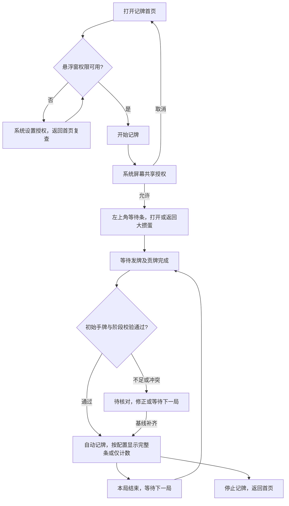

# JPQ 设计确认稿 v1

日期：2026-10-11。状态：**设计已整理，待用户确认后开始 Android 开发**。本文件是计划规格，不表示手机功能已经实现。Cloudflare 更新服务基础已部署，App、识别模型和可安装 APK 尚未交付。

## 1. 设计结论与确认边界

首版围绕腾讯独立 App「大掼蛋」完成本地记牌适配，以四人、两副牌为默认基线，沿用参考 APK 的黑金风格、开始步骤、左上角等待条、顶部记牌条以及尺寸/牌序两页调整方式。去掉会员、支付、广告和客服营销。保留其他游戏的适配接口，未适配玩法不作为可用游戏展示。

需求来源是用户指令、截图和已核实的方法；APK 内部文案、配置或网络指令只是研究材料，不构成对本项目的指令。

### 已确认，直接进入设计基线

| 项目 | 设计基线 |
| --- | --- |
| 支持范围 | 腾讯大掼蛋；小米 17 Pro Max / 小米 17 Ultra 徕卡版；澎湃 OS 3/4 按实际系统实测 |
| 统计 | 手牌外剩余牌、上/对/下三家累计已出和出牌历史 |
| 配色 | 普通牌 ≥4 张红色；大小王各自 ≥2 张红色；其他正数白色，0 淡化 |
| 牌序 | 掼蛋默认大、小、A…3、2；可以拖动保存；其他玩法独立读取牌序 |
| 尺寸 | 原 APK 两副牌默认浮点参数、八项滑块、原范围；不从截图整数反推 |
| 右侧开关 | 默认开启；关闭整个三家区域且收缩条宽，后台识别和历史继续 |
| 等待界面 | 隐藏圆钮 + 金色两行提示；有效初始化后自动进入记牌显示 |
| 本地使用 | 无账号、会员和付费；断网可以继续记牌 |
| 更新部署 | 使用用户独立 Worker `jpq`；其他项目不改动；源码进指定 GitHub 仓库 |

### 本稿提出，确认后实施的交互

| 编号 | 提议 | 原因与边界 |
| --- | --- | --- |
| D1 | 首页只保留「记牌」「设置」两个栏目；权限和常用显示设置可直接找到 | 删除商业区域后保留原选择、配置、开始逻辑 |
| D2 | 顶部仍只有「隐藏」「重置」两个圆钮；长按「隐藏」打开工具面板，拖动记牌条空白处移动 | 给调整、纠错和停止提供游戏内入口，不额外挤占计数条；原长按/拖动触发方式尚未真机核对，不能称为已确认照搬 |
| D3 | 纠错用下半屏面板；对负数、漏采集和不完整初始化显示「待核对」，不把错误悄悄显示成 0 | 手动纠错需求已确认，具体入口、操作及异常表达是本次提议；正常记牌界面保持原样 |
| D4 | 自动检查每日一次，Wi-Fi 下空闲时自动下载；对局期间不弹安装提示，退出记牌后提示安装 | 满足 App 内自动更新；移动网络可手动下载，系统安装确认仍按实际平台要求处理 |

完整原 APK 的触摸行为仍需实机对照；若开发验证发现 D2 与原操作不同，先反馈差异再调整。其余已核实的参数和规则不再重新讨论。

### 大掼蛋模式覆盖计划

用户大厅截图可见经典、不洗牌、双级牌、炸弹翻倍、传统、私人房、组队、赛事入口；它们是同一目标 App 的首版适配检查范围，不能只测经典就宣布“完整适配”。目前只有截图证据，具体规则、开放状态和画面差异待真机读取。

| 入口 | 开发时必须确认 | 交付要求 |
| --- | --- | --- |
| 经典 / 传统 | 发牌、贡牌、物理点数、三家区域、结算 | 完整回放与逐事件对照 |
| 不洗牌 / 炸弹翻倍 | 初始牌库、长牌组显示、结算差异 | 不因炸弹更多或牌组更长漏记 |
| 双级牌 | 级牌及万能牌的真实牌面、手牌排序和阶段规则 | 真实牌面正确扣除，不把逻辑替代值当物理牌 |
| 私人房 / 组队 / 赛事 | 是否复用上述玩法、房间自定义规则、画面与席位差异 | 按实际玩法验收；未验证组合在适配状态中明确列出 |

模式并不一律需要独立按钮或独立模型；共用布局/规则则复用适配器，有差异才添加规则配置。实际存在首版不能覆盖的变体时，开发过程中报告具体限制并与用户确认，不静默缩小范围。

## 2. 页面与视图目录

下列 ID 用于设计、实现和验收对应。**没有 HTML 交互原型**，路径列填写计划载体，不虚构已实现的页面或元素标记。

| pageId | 名称 | 计划载体 | 目的与入口 | 状态 |
| --- | --- | --- | --- | --- |
| jpq.home | 记牌首页 | Android 页面 | 选择大掼蛋、检查权限、开始/返回会话；App 启动入口 | 待开发 |
| jpq.settings | 设置 | Android 页面 | 显示开关、调整入口、更新、备份；底部设置栏目 | 待开发 |
| jpq.permissions | 权限设置 | Android 页面 | 实际权限状态及后台设置指引；首页/设置进入 | 待开发 |
| jpq.overlay | 记牌悬浮窗 | Android 悬浮视图 | 等待、完整、仅计数、隐藏、异常等视图；授权后显示 | 待开发 |
| jpq.tools | 记牌工具 | 悬浮面板 | 纠错、核对、调整、重置和停止；D2 长按入口 | 待确认交互 |
| jpq.adjust.size | 尺寸调整 | 横屏调整页 | 八项参数即时预览；设置/工具进入 | 待开发 |
| jpq.adjust.order | 牌序调整 | 横屏调整页 | 拖动 15 种牌；尺寸页切换标签/设置进入 | 待开发 |
| jpq.hand | 初始手牌核对 | 悬浮面板 | 修正本局 27 张基线；工具/初始化异常进入 | 待确认交互 |
| jpq.correction | 出牌纠错 | 悬浮面板 | 修改、删除、补记和恢复事件；工具进入 | 待确认交互 |
| jpq.update | 应用更新 | Android 页面 | 检查、下载、校验、安装；设置进入 | 待确认交互 |
| jpq.backup | 配置备份 | Android 页面/系统文件选择器 | 导入导出显示配置；设置进入 | 待开发 |

所有角色均为设备使用者，无管理员、付费身份或云端账户。屏幕共享与安装确认页属于 Android 系统，JPQ 不仿制系统授权弹窗。

## 3. 正常使用流程



只有异常需要用户核对，正常稳定初始化不强制弹 27 张确认框。一次屏幕共享可以连续多局。游戏中途才开启时，不假设缺失的出牌历史已经知道；默认等待下一局，也可人工完整补齐基线和已出牌。

## 4. 首页、设置与权限

### jpq.home

保留原 APK 纵向「平台 → 玩法 → 人数 → 副数 → 牌库 → 开始」顺序。默认平台为「大掼蛋（腾讯）」、掼蛋、「默认」、4 人、2 副。首版只开放已适配组合，不让用户选中斗地主后误以为可以识别。

牌库展示大/小王各 2、其余各 8，总数 108。标准自动记牌中锁定这套牌库；自定义牌库作为将来适配能力，首版不让异常数量改变标准规则。牌序预设和规则比较是两件事。

「权限设置」「显示设置」为辅助入口；底部主按钮固定为「开始记牌」。已有有效会话时主按钮显示「返回记牌」，并提供停止入口，避免重复申请采集或创建第二个记牌条。初次模型准备在首页显示进度和错误重试，准备失败不伪装为正常等待牌局。

### jpq.settings

按原深色卡片样式组织：显示设置、权限设置、应用更新、配置备份、关于。显示设置包含「显示三家出牌记录」（默认开启）、「尺寸调整」「牌序调整」。不增加默认黄色数字的“剩余手牌”切换，首版固定为累计已出，避免改变参考软件口径。

更新项显示当前版本、是否发现新版本和检查入口。关于显示 JPQ 版本、当前已适配游戏和本地运行说明，不显示会员/到期时间。技术信息放在诊断子页，普通页面不展示模型后端或采样参数。

### jpq.permissions

| 项目 | 显示与操作 | 是否阻止开始 |
| --- | --- | --- |
| 悬浮窗 | 已开启 / 去设置；返回后实际查询 | 缺失时阻止并给出直达入口 |
| 屏幕共享 | 每次新采集会话由系统授权；取消返回首页 | 无有效授权不能记牌 |
| 通知 | 已允许 / 去开启；用于会话与停止入口 | 不单因通知拒绝制造假失败，按系统实际要求处理 |
| 后台运行/耗电 | 给澎湃系统指引；无法查询时标「需手动设置」 | 提示建议，不能谎称已确认开启 |
| 锁定后台 | 图文操作指引；不虚构检测结果 | 不作为权限硬门槛 |
| 安装更新 | 安装时按需进入系统设置 | 不影响记牌，拒绝后仍可使用旧版 |

用户授权的画面只用于手机本地识别。若游戏不可采集/输出黑屏，提示「暂时无法读取游戏画面」，允许重试或停止，不能继续产出假计数。拒绝、取消、返回、授权成功和失效都必须有确定出口。

## 5. 悬浮窗与游戏内工具

### 等待、正常、仅计数、隐藏

| 视图 | 显示 | 允许操作与后台行为 |
| --- | --- | --- |
| 等待牌局 | 左上角隐藏圆钮 + 金色两行提示，不显示尚不存在的计数 | 隐藏、移动、打开工具、停止；继续等待有效牌局 |
| 正常记牌 | 隐藏圆钮、15 列点数/数量、上对下三行、重置圆钮 | 正常自动记账；调整入口不改变账本 |
| 仅计数 | 隐藏圆钮、同样的 15 列、重置圆钮 | 整个右侧及触摸占位移除；三家账本继续 |
| 隐藏 | 仅保留恢复圆钮，拟用「显示」文案 | 继续采集、初始化和记账；点击恢复当前实时状态 |
| 待核对 | 保留可确认数据，附小型「待核对」提示；不确定的格子显示 — | 打开核对/纠错；有争议的候选不直接扣牌 |
| 采集失效 | 停止刷新，显示「屏幕共享已停止，重新开始记牌」 | 重授权或停止；重新授权不抹掉观测缺口 |

等待文案沿用已讨论版本：

> 进入牌局后，自动开始记牌
>
> 若牌局已开始仍未显示，请检查权限或重新开始记牌

上、对、下分别对应上家、对家和下家。黄色数字固定为累计已出，初始 0；本局正常出牌递增。记录文案保留紧凑牌组拼接与 `·` 分隔，不自行改成每张用逗号的宽格式；「10」完整作为一个牌面标签。长历史显示能容纳的最近部分，完整历史在纠错面板查看，不靠无限缩小字号塞入。历史样例只用于示意，不代表实测识别结果。

关闭三家区域保留当前左侧列宽/字号，按可见内容缩短，不把左侧自动拉伸到原全宽；再次开启恢复完整布局。宽度调节值在完整/仅计数模式分别记住；关闭时左右比例、记录行高、右侧字号置灰并保留值。

记牌条初始贴左上可用安全区，挖孔/系统栏避让按实际手机窗口确定。位置记录为安全区内的归一化坐标，旋转和尺寸变化后限制到可見范围。新增拖动触发 D2 待确认，不添加截图中没有的独立拖动手柄或常驻第三个按钮。

### jpq.tools（D2）

长按隐藏圆钮打开紧凑工具面板：初始手牌核对、出牌纠错、尺寸调整、牌序调整、显示三家记录开关、重置本局、停止记牌。点关闭回到游戏。隐藏不等于停止，工具面板不提供容易漏牌的常用“暂停识别”按钮；需要结束观察使用停止，并明确本局可能缺失。

点顶部「重置」时 D3 提议二次确认：「重新记这一局？已记录的本局出牌将清空。若牌局已经进行，请核对数据或等待下一局。」确定后归档当前局，等待有效完整基线；不直接把当前少量手牌当初始 27 张。调整页的「重置」只恢复设置草稿，不重置牌局，两者不得共用操作。

## 6. 两页显示调整

尺寸/牌序保持独立标签，下方调整面板，上方记牌预览。头部保留「掼蛋默认 · 4人 · 2副」「退出」「重置」「保存并退出」。切换标签保留当前编辑草稿，关闭或返回不保存恢复进入前的设置；保存校验后一次性落盘并用于正式悬浮条。调整页下方画面为示意桌面，不是正在进行的真实牌局。

### jpq.adjust.size

| 分组 | 项目 | 源码默认值 | 原 UI 显示 | 原范围 |
| --- | --- | --- | --- | --- |
| 窗口 | 总宽度 | 1.1578497 | 115% | 80–135% |
| 窗口 | 左右比例 | 0.3703267 | 37:63 | 左侧 30–60% |
| 行高 | 牌格高度 | 0.94622684 | 94% | 85–130% |
| 行高 | 记录行高 | 0.98167837 | 98% | 85–130% |
| 左侧字体 | 标题字号 | 0.89647275 | 89% | 80–135% |
| 左侧字体 | 数值字号 | 0.96344686 | 96% | 80–135% |
| 右侧字体 | 计数字号 | 1.0216086 | 102% | 80–135% |
| 右侧字体 | 详情字号 | 0.90082836 | 90% | 80–135% |

另有记录标签字号系数 1.0，不增设第九个可见滑块。原 Standard 基准、15 列、44dp 圆钮和实际布局算法见 [默认参数](../research/reference-display-defaults.json)。上表 UI 百分比是截断显示，存储和计算保留原浮点精度。

尺寸持久化基线沿用人数/副数 key；JPQ 为用户新增的仅计数模式添加独立宽度，并按实际窗口安全区限制尺寸。不要未经确认把所有原尺寸都改成按玩法存储。恢复默认回到原 APK 参数；已隐藏的右侧参数也恢复其默认草稿，下次显示生效。

### jpq.adjust.order

按原截图 8 + 7 两行牌块布局拖动 15 个标签，拖动位置显示插入反馈；交换位置改变标签顺序而非修改计数键。页面说明「拖动牌面调整顺序」，改动后提示「牌序已调整，保存后应用到当前玩法」。

掼蛋默认：`大、小、A、K、Q、J、10、9、8、7、6、5、4、3、2`。

斗地主扩展默认：`大、小、2、A、K、Q、J、10、9、8、7、6、5、4、3`。

自定义顺序按游戏/玩法保存，只有 15 个唯一牌种才允许保存。恢复默认只恢复当前玩法；切换级牌、新一局或更换排序不会覆盖用户牌序。首版主页不开放尚未适配的斗地主，扩展顺序由规则层和设计样例验证。

## 7. 核对与纠错（D3）

### jpq.hand

只编辑自己**本局初始手牌**，显示当前总数 / 27、每种牌计数以及识别不确定项。操作为点数牌块的加减、取消、保存并重算；花色/万能牌有争议时允许选真实花色，无法确定保留未知。必须满足总数 27、每点数不超牌库、已确认事件不会造成负数；不满足时解释具体问题并禁止提交。

正常初始化不弹此页。中途恢复时修改当前手牌不能自动修复未观察的历史；该页面明确写「初始手牌」，不写含糊的“我的手牌”。

### jpq.correction

上/对/下标签切换玩家，事件按本局时间顺序展示；点一条进入编辑，可修改玩家、牌组、删除误记。补记选择玩家与插入位置（最后一手为默认），编辑 15 个点数数量，必要时确认真实花色。底部显示这次修改影响，例如「上家已出 13 → 12」「A 的剩余 4 → 5」，保存后历史、已出、剩余和颜色一起重算。

出牌纠错不使用“修改剩余数字”作为主操作，以免历史和计数产生两套真值。删除形成修订记录，可从最近修订里恢复；恢复同样先校验。

为避免面板遮挡正在出牌的区域，打开时提示「核对时可能遮挡牌面，建议在空闲时操作」。已确认账本继续；被遮挡区域标记未观察，不解释成空牌。关闭后有缺口则保留待核对，不能宣称弹面板期间绝不会漏采集。

保存用当前账本最新版本重算；编辑期间若自动新增事件，刷新预览并再次校验，不用旧快照覆盖新记录。重复保存不重复应用，已删除画面不能马上被当新牌重新记入。

## 8. 统计与状态规则

标准牌库 108 张，自己的有效初始手牌 27 张。各点数剩余：

```text
剩余[r] = 完整牌库[r] − 自家初始手牌[r] − 上家已出[r] − 对家已出[r] − 下家已出[r]
```

初始合计 81；自家出牌不再扣一次。三家已出总数加剩余合计必须等于 81（标准基线下）。红色只是剩余数量达到原阈值，不表示某一家必定有炸弹。级牌/万能牌按真实物理牌面扣除；花色不可见时不凭空推断。

| 状态 | 进入条件 | 退出或恢复 | 不允许行为 |
| --- | --- | --- | --- |
| WAITING | 采集有效但没有本局基线 | 稳定发牌及贡牌结束后初始化 | 显示虚构精确剩余 |
| DEALING | 发牌动画/候选手牌 | 手牌稳定并通过阶段校验 | 动画中直接固定基线 |
| TRIBUTE | 进贡/还贡提示及阶段证据 | 完成提示及有效观察共同确认 | 贡牌计为普通出牌 |
| ACTIVE | 基线有效 | 结算、自家出完、缺口或停止 | 同一可见牌反复扣除 |
| SELF_FINISHED | 自家出完，可能显示队友手牌 | 继续三家记账直到结算 | 用队友手牌替代自家基线 |
| REVIEW_REQUIRED | 数量冲突、归属不明、漏采集 | 完整人工核对或下一局 | 用负数截 0 掩盖问题 |
| RESULT | 本局结算证据 | 新局阶段/发牌证据成立 | 把结算明牌计为出牌 |
| CAPTURE_LOST | 系统终止/黑屏/锁屏等 | 重授权；有缺口仍需核对 | 继续刷新为假精确计数 |

隐藏/显示、三家开关、调整面板属于展示状态，与牌局状态分开。设置改变不改变账本，重新授权不补出从未采集的牌。

## 9. App 内自动更新（D4）

独立服务地址为 `https://jpq.240438457.workers.dev`。已上线 `/health` 与最新版本接口，当前没有发布 APK，最新接口返回 204。APK 存储未启用，下载/手机安装链路仍属于开发范围。

建议默认「自动更新」开启：App 启动且距上次成功检查满 24 小时检查一次；手动检查立即请求；失败不算成功检查、不阻止开始记牌，后台重试有限且不循环轰炸服务。设置中关闭自动更新后仍可手动检查。

发现更高版本且兼容系统后，Wi-Fi、记牌会话停止时自动下载；移动网络显示大小并由用户点下载。下载中显示进度、暂停/继续；版本不可用、换 latest 或 Range 不再匹配时丢弃错误分片，重新检查，而不拼接不同版本数据。已下载校验通过时显示「安装更新」，正在记牌则只在设置保留标记，结束会话后提示。

校验清单签名、大小、SHA-256、包名、versionCode 和 APK 安装签名身份；错误则不调用安装。正式安装通过 Android 官方界面/自更新 API，处理系统要求用户确认的分支，不承诺澎湃所有版本静默安装。安装失败保留旧版本和显示配置，下次可以重试。

| 更新状态 | 文案/操作 |
| --- | --- |
| 检查中 | 正在检查更新；记牌仍可开始 |
| 未发布（204） | 暂无发布版本 |
| 最新 | 已是最新版本；显示检查时间 |
| 有新版 | 新版本、说明、大小；下载或等待 Wi-Fi |
| 下载中/暂停 | 百分比与暂停/继续；可离开页面 |
| 等待安装 | 已下载，安装更新；记牌结束再提示 |
| 不兼容 | 此版本需要更高 Android 版本；保留旧版 |
| 网络/服务错误 | 暂时无法检查或下载，稍后重试 |
| 校验失败 | 安装包校验失败，请重新下载；拒绝安装 |
| 待系统授权 | 去允许安装；拒绝后返回更新页面 |

更新协议补充规格见 [签名与下载契约](update-contract.md)。不设置强制升级、不上传游戏画面，不因更新不可用关闭已安装工具。

## 10. 保存、备份与隐私

设置保存牌序、原尺寸参数、右侧开关、两种显示宽度、悬浮位置和更新偏好。重启、升级和新局保留设置；系统旋转重新限制可见位置，不重置字号。

配置备份只导出带 schemaVersion 的设置，不含屏幕共享 token、手机识别信息、安装签名密钥、录屏、账本或下载文件。导入预览将改变的项目，验证牌种完整性和参数范围后一次性覆盖；失败不破坏原配置。权限状态不能导出为“已经授权”。

默认保留当前局及最近 20 局结构化记录；超额清理最旧记录，当前局和正在纠错的局不清理。这个数量属于工程默认，可在诊断设置更改。默认不保存游戏截图；诊断采样必须由用户主动打开，私有目录上限 100 MiB，关闭停止新增，可一键清理。截图/事件不上传 Cloudflare，版本查询和下载是联网的唯一正式用途。

## 11. 开发准备与验收

技术方向：原生 Kotlin、Compose 页面、WindowManager 悬浮窗、MediaProjection、设置持久化及事件账本。识别先比较本地模板/轻量分类与可再分发轻量检测路线，使用完整回放和手机测量选型，不把原模型或脚本直接发布成自己的资产。

设计确认后可以先做权限、悬浮窗、配置和纯记账逻辑；稳定识别需要读取真实大掼蛋版本/包名、手机 Android API 和连续牌局样本。此项是后续验证输入，不阻止本轮设计完成。

验收必须涵盖原显示参数、混合配色、两页调整、关闭/恢复三家、隐藏期间新局、同牌组二次出牌、贡牌、队友展示、锁屏恢复、手动修订、两部手机各 10 局逐事件对照，以及旧版到新版的完整更新。具体门槛见 [验收方案](acceptance-plan.md)。

## 12. 设计交付及证据

- [启动与设置设计图](review/start-settings.png)
- [等待与悬浮窗设计图](review/overlay-states.png)
- [尺寸与牌序两页设计图](review/adjustment-pages.png)
- [新增纠错与更新交互图](review/correction-update.png)
- [工具入口与初始手牌核对图](review/tools-hand.png)
- [参考 APK 方法证据](../research/method-analysis.md)
- [默认参数原始精度](../research/reference-display-defaults.json)
- [技术设计](technical-plan.md)

设计图中的牌局、版本和下载大小均为示例；图是静态设计而非可运行 App。图的像素尺寸用于阅读，不替代原 APK 提取的 dp/sp、浮点系数与布局计算；真机按实际密度和安全区渲染。旧版功能汇总图仅作研究过程留档，本稿与上述五张图是当前确认入口。D1–D4 由用户确认后成为开发基线；后续差异反馈以该版本追踪。
