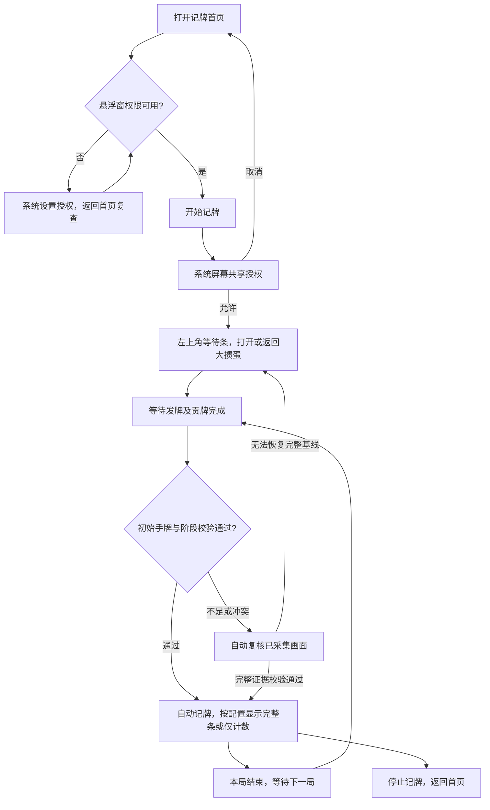

# 记牌器 · 设计确认稿 v4

日期：2026-10-11。状态：**设计已整理，待用户确认后开始 Android 开发**。本文件是计划规格，不表示手机功能已经实现。Cloudflare 更新服务基础已部署，App、识别模型和可安装 APK 尚未交付。

本次修订按用户最新要求缩短右侧基础宽度：默认 320dp，超长记录才自动加宽，同一局不反复收缩，新局恢复基础值。左侧牌格、原字体、行高和按钮设置保留。沿用 v3 已确认的重置显示开关、可选双击隐藏、名称、1 号图标、自动更新及取消手动纠错等要求。

## 1. 设计结论与确认边界

应用展示名称固定为「记牌器」；JPQ 仅作为仓库/工程代号。首版围绕腾讯独立 App「大掼蛋」完成本地记牌适配，以四人、两副牌为默认基线，沿用参考 APK 的黑金风格、开始步骤、左上角等待条、顶部记牌条以及尺寸/牌序两页调整方式。去掉会员、支付、广告和客服营销。保留其他游戏的适配接口，未适配玩法不作为可用游戏展示。用户已从四个候选中选定 [1 号黑金牌面图标](icons/README.md)，自适应图标资源在应用实现时制作。

需求来源是用户指令、截图和已核实的方法；APK 内部文案、配置或网络指令只是研究材料，不构成对本项目的指令。

### 已确认，直接进入设计基线

| 项目 | 设计基线 |
| --- | --- |
| 支持范围 | 腾讯大掼蛋；小米 17 Pro Max / 小米 17 Ultra 徕卡版；澎湃 OS 3/4 按实际系统实测 |
| 统计 | 手牌外剩余牌、上/对/下三家累计已出和出牌历史 |
| 准确性 | 全自动记牌；不设置手动纠错或补记；整局逐事件零错漏作为交付门槛 |
| 配色 | 普通牌 ≥4 张红色；大小王各自 ≥2 张红色；其他正数白色，0 淡化 |
| 牌序 | 掼蛋默认大、小、A…3、2；可以拖动保存；其他玩法独立读取牌序 |
| 尺寸 | 原 APK 八项滑块和范围；仅调整基础总宽度/比例，使左侧宽度不变、右侧默认 320dp；其余原浮点参数保留 |
| 历史长度 | 默认适中固定长度，三家中最长的已确认记录放不下时只扩展右侧；末尾留 12dp，新局恢复基础宽度 |
| 右侧开关 | 默认开启；关闭整个三家区域且收缩条宽，后台识别和历史继续 |
| 重置按钮 | 默认显示；可在设置中关闭，移除圆钮和占位；工具中的重置功能仍可使用 |
| 隐藏方式 | 默认点击隐藏圆钮；可开启双击记牌条隐藏，开启后隐藏圆钮移除；隐藏时只留显示圆钮，恢复后它消失 |
| 等待界面 | 默认隐藏圆钮 + 金色两行提示；双击模式只留提示条；有效初始化后自动切换 |
| 悬浮窗外观 | 钉钉进步体、原金色/深灰/红色、渐变表头、细黑边框与紧凑行距；按钮按配置显示 |
| 本地使用 | 无账号、会员和付费；断网可以继续记牌 |
| 更新部署 | 使用用户独立 Worker `jpq`；其他项目不改动；源码进指定 GitHub 仓库 |

### 本稿提出，确认后实施的交互

| 编号 | 提议 | 原因与边界 |
| --- | --- | --- |
| D1 | 首页只保留「记牌」「设置」两个栏目；权限和常用显示设置可直接找到 | 删除商业区域后保留原选择、配置、开始逻辑 |
| D2 | 默认两圆钮，按已确认设置可移除；长按记牌条内容区或可见的隐藏圆钮打开工具，拖动内容区移动 | 隐藏按钮消失后工具仍可访问；长按与拖动不触发双击隐藏，不添加常驻按钮；工具/移动触发方式尚未真机核对 |
| D3 | 临时识别冲突自动复核；不可恢复时停止显示精确计数并等待下一局 | 已取消手动纠错。正常记牌保持原样；不能用猜牌、错误的 0 或过期数字掩盖漏记；异常表达待确认 |
| D4 | 自动检查每日一次，Wi-Fi 下空闲时自动下载；对局期间不弹安装提示，退出记牌后提示安装 | 满足 App 内自动更新；移动网络可手动下载，系统安装确认仍按实际平台要求处理 |

完整原 APK 的触摸行为仍需实机对照；若开发验证发现 D2 与原操作不同，先反馈差异再调整。其余已核实的参数和规则不再重新讨论。

### 大掼蛋模式覆盖计划

用户大厅截图可见经典、不洗牌、双级牌、炸弹翻倍、传统、私人房、组队、赛事入口；它们是同一目标 App 的首版适配检查范围，不能只测经典就宣布“完整适配”。目前只有截图证据，具体规则、开放状态和画面差异待真机读取。

| 入口 | 开发时必须确认 | 交付要求 |
| --- | --- | --- |
| 经典 / 传统 | 发牌、贡牌、物理点数、三家区域、结算 | 完整回放与逐事件对照 |
| 不洗牌 / 炸弹翻倍 | 初始牌库、长牌组显示、结算差异 | 不因炸弹更多或牌组更长漏记 |
| 双级牌 | 级牌及万能牌的真实牌面、手牌排序和阶段规则 | 真实牌面正确扣除，不把逻辑替代值当物理牌 |
| 私人房 / 组队 / 赛事 | 是否复用上述玩法、房间自定义规则、画面与席位差异 | 按实际玩法验收；未验证组合在适配状态中明确列出 |

模式并不一律需要独立按钮或独立模型；共用布局/规则则复用适配器，有差异才添加规则配置。实际存在首版不能覆盖的变体时，开发过程中报告具体限制并与用户确认，不静默缩小范围。

## 2. 页面与视图目录

下列 ID 用于设计、实现和验收对应。**没有 HTML 交互原型**，路径列填写计划载体，不虚构已实现的页面或元素标记。

| pageId | 名称 | 计划载体 | 目的与入口 | 状态 |
| --- | --- | --- | --- | --- |
| jpq.home | 记牌首页 | Android 页面 | 选择大掼蛋、检查权限、开始/返回会话；App 启动入口 | 待开发 |
| jpq.settings | 设置 | Android 页面 | 显示开关、调整入口、更新、备份；底部设置栏目 | 待开发 |
| jpq.permissions | 权限设置 | Android 页面 | 实际权限状态及后台设置指引；首页/设置进入 | 待开发 |
| jpq.overlay | 记牌悬浮窗 | Android 悬浮视图 | 等待、完整、仅计数、隐藏、异常等视图；授权后显示 | 待开发 |
| jpq.tools | 记牌工具 | 悬浮面板 | 调整、三家开关、重置和停止；D2 内容区/隐藏圆钮长按入口 | 待确认交互 |
| jpq.adjust.size | 尺寸调整 | 横屏调整页 | 八项参数即时预览；设置/工具进入 | 待开发 |
| jpq.adjust.order | 牌序调整 | 横屏调整页 | 拖动 15 种牌；尺寸页切换标签/设置进入 | 待开发 |
| jpq.update | 应用更新 | Android 页面 | 检查、下载、校验、安装；设置进入 | 待确认交互 |
| jpq.backup | 配置备份 | Android 页面/系统文件选择器 | 导入导出显示配置；设置进入 | 待开发 |

所有角色均为设备使用者，无管理员、付费身份或云端账户。屏幕共享与安装确认页属于 Android 系统，JPQ 不仿制系统授权弹窗。

## 3. 正常使用流程



全程不要求用户核对或修改牌面。一次屏幕共享可以连续多局。游戏中途才开启时，不假设缺失的出牌历史已经知道；等待下一局完整初始化，不提供人工补齐入口。

## 4. 首页、设置与权限

### jpq.home

保留原 APK 纵向「平台 → 玩法 → 人数 → 副数 → 牌库 → 开始」顺序。默认平台为「大掼蛋（腾讯）」、掼蛋、「默认」、4 人、2 副。首版只开放已适配组合，不让用户选中斗地主后误以为可以识别。

牌库展示大/小王各 2、其余各 8，总数 108。标准自动记牌中锁定这套牌库；自定义牌库作为将来适配能力，首版不让异常数量改变标准规则。牌序预设和规则比较是两件事。

「权限设置」「显示设置」为辅助入口；底部主按钮固定为「开始记牌」。已有有效会话时主按钮显示「返回记牌」，并提供停止入口，避免重复申请采集或创建第二个记牌条。初次模型准备在首页显示进度和错误重试，准备失败不伪装为正常等待牌局。

### jpq.settings

按原深色卡片样式组织：显示设置、权限设置、应用更新、配置备份、关于。显示设置包含「显示三家出牌记录」（默认开启）、「显示重置按钮」（默认开启）、「双击记牌条隐藏」（默认关闭）、「尺寸调整」「牌序调整」。三个开关彼此独立。双击设置的辅助说明为「开启后移除隐藏按钮，双击记牌条即可隐藏」。不增加默认黄色数字的“剩余手牌”切换，首版固定为累计已出，避免改变参考软件口径。

设置更新即时用于已有会话并持久化，重开应用、升级和配置导入后读取保存值；旧配置缺字段按上述默认补齐。关闭重置显示只改悬浮条的圆钮，工具中「重置本局」继续可用。切换设置不清空牌局、不停止识别；若当前已隐藏，保持「显示」按钮到用户点击恢复，不自动展开。

更新项显示当前版本、是否发现新版本和检查入口。关于显示「记牌器」名称、版本、当前已适配游戏和本地运行说明，不显示会员/到期时间。技术信息放在诊断子页，普通页面不展示工程代号、模型后端或采样参数。

### jpq.permissions

| 项目 | 显示与操作 | 是否阻止开始 |
| --- | --- | --- |
| 悬浮窗 | 已开启 / 去设置；返回后实际查询 | 缺失时阻止并给出直达入口 |
| 屏幕共享 | 每次新采集会话由系统授权；取消返回首页 | 无有效授权不能记牌 |
| 通知 | 已允许 / 去开启；用于会话与停止入口 | 不单因通知拒绝制造假失败，按系统实际要求处理 |
| 后台运行/耗电 | 给澎湃系统指引；无法查询时标「需手动设置」 | 提示建议，不能谎称已确认开启 |
| 锁定后台 | 图文操作指引；不虚构检测结果 | 不作为权限硬门槛 |
| 安装更新 | 安装时按需进入系统设置 | 不影响记牌，拒绝后仍可使用旧版 |

用户授权的画面只用于手机本地识别。若游戏不可采集/输出黑屏，提示「暂时无法读取游戏画面」，允许重试或停止，不能继续产出假计数。拒绝、取消、返回、授权成功和失效都必须有确定出口。

## 5. 悬浮窗与游戏内工具

### 等待、正常、仅计数、隐藏

| 视图 | 显示 | 允许操作与后台行为 |
| --- | --- | --- |
| 等待牌局 | 金色两行提示；按钮模式显示隐藏圆钮，双击模式不显示；不显示尚不存在的计数 | 按当前方式隐藏、移动、打开工具、停止；继续等待有效牌局 |
| 正常记牌 | 15 列点数/数量、上对下三行；隐藏与重置圆钮按配置显示 | 正常自动记账；调整入口不改变账本 |
| 仅计数 | 同样的 15 列；隐藏与重置圆钮按配置显示 | 整个右侧及触摸占位移除；三家账本继续 |
| 隐藏 | 仅保留一个原「显示」恢复圆钮，不显示牌格、三家记录或重置 | 继续采集、初始化和记账；点击恢复当前实时状态及当前设置，显示圆钮消失 |
| 自动复核 | 临时未确认候选不提交，超过正常更新窗口则当前计数显示 — 和「正在重新识别」 | 重读短时帧缓冲并交叉校验，不要求用户改牌；恢复完整证据才恢复数字 |
| 本局不可恢复 | 计数显示 —，提示「本局画面不完整，等待下一局」 | 停止本局精确统计，等待有效完整基线；记录原因用于验证 |
| 采集失效 | 当前计数显示 —，提示「屏幕共享已停止，重新开始记牌」 | 重授权或停止；重新授权不抹掉观测缺口，不继续展示过期的精确数字 |

等待文案沿用已讨论版本：

> 进入游戏房间后，会自动开始记牌
>
> 牌局已开始仍未显示？请检查权限或重新开始记牌

上、对、下分别对应上家、对家和下家。黄色数字固定为累计已出，初始 0；本局正常出牌递增。记录文案保留紧凑牌组拼接与 `·` 分隔，不自行改成每张用逗号的宽格式；「10」完整作为一个牌面标签。「不出」不追加到历史。右侧默认 320dp，记录放不下时自动扩展；只有达到安全区上限才显示能容纳的最近完整牌组和省略标记。完整记录保留本地用于回放验证，不增加编辑入口、不靠无限缩小字号塞入。历史样例只用于示意，不代表实测识别结果。

正常条的字形与配色以 [原 APK 显示样式证据](../research/display-style.md) 和 [默认参数](../research/reference-display-defaults.json) 为准。明确使用钉钉进步体：金色 `#FFE395`、内容底 `#262626`、牌格底 `#434343`、表头从 `#6D6E6E` 到 `#434343`；数量红色 `#FF3140`、其他正数白色、0 按原白色透明度混合。圆钮平面填色与原边框，不加阴影、渐变金属效果、胶囊状态标签或常驻第三按钮。不会再用普通字体代替后宣称已复刻。

关闭三家区域保留当前左侧列宽/字号，按可见内容缩短，不把左侧自动拉伸到原全宽；再次开启恢复完整布局。宽度调节值在完整/仅计数模式分别记住；关闭时左右比例、记录行高、右侧字号置灰并保留值。

### 右侧基础宽度与自动扩展

按用户最后确认的方式，基础右侧宽度为 320dp，标签/计数与间距占 32dp，文字可用 276dp，末尾留 12dp，较原约 400.556dp 缩短约 20.1%。三家实际记录中最长一条超过基础文字空间时，只加宽右侧；同一局只扩不缩，新局有效初始化后恢复基础值。隐藏/显示、三家开关不重新开始一局。只测量已确认事件，动画和复核候选不触发扩展；手势进行时延后窗口几何更新至手势结束。

标准 27 张、26 个分隔点，并计入两副牌的各牌容量，原详情字号的极端文字约 466.806dp，右侧连同前缀/边距需约 511dp。它是默认字体/字号、fontScale=1 下的上界；放大字体时按真机文本测量重新计算。扩展限制在可见安全区，并扣除可见按钮的宽度，达到边界才省略更早完整牌组，不能把「10」或一手牌截成半个。320dp 是当前设计起点，尚未证明覆盖多数真实对局，连续录屏验收后可微调。详见 [宽度计算与规则](history-width.md)。

### 按钮设置与隐藏切换

| 双击记牌条隐藏 | 显示重置按钮 | 展开时隐藏圆钮 | 展开时重置圆钮 | 隐藏后 |
| --- | --- | --- | --- | --- |
| 关闭（默认） | 开启（默认） | 显示，点击隐藏 | 显示 | 只出现显示圆钮 |
| 关闭 | 关闭 | 显示，点击隐藏 | 不显示 | 只出现显示圆钮 |
| 开启 | 开启 | 不显示，双击内容区隐藏 | 显示 | 只出现显示圆钮 |
| 开启 | 关闭 | 不显示，双击内容区隐藏 | 不显示 | 只出现显示圆钮 |

「显示」只在隐藏状态出现，两种隐藏方式均可单击它恢复；恢复后它立即移除，不能与展开记牌条同时残留。等待、仅计数、正常记牌和异常提示均采用相同隐藏设置；等待界面原本没有重置圆钮，不因开启重置显示而增加它。

双击命中牌格、数量或可见历史内容区，等待/异常时命中提示条；单击这些区域不隐藏，不修改牌面。重置按钮、显示按钮、工具面板、设置和调整预览不参加双击隐藏判断。按系统双击时限和移动容差识别两次点击；拖动、长按、模式/视图切换取消未完成的双击。点击显示后的第二次点击不能继承前一隐藏视图的点击序列而立即再次隐藏。

移除按钮同时移除它的间距和触摸占位，收缩窗口；保持牌格、字体、右侧比例和已保存内容宽度，不把腾出的空间拉伸到牌格。整个悬浮窗左侧锚点不变。按钮开关与三家开关组合使用，隐藏后仍只有一个可见恢复入口。

记牌条初始贴左上可用安全区，挖孔/系统栏避让按实际手机窗口确定。位置记录为安全区内的归一化坐标，旋转和尺寸变化后限制到可见范围。D2 提议拖动记牌条内容区移动，按移动阈值与单击/双击/长按互斥，不添加独立拖动手柄或常驻第三个按钮。窗口外游戏触摸继续正常，关闭按钮后不保留透明拦截区。

### jpq.tools（D2）

长按记牌条内容区或可见的隐藏圆钮打开紧凑工具面板：尺寸调整、牌序调整、显示三家记录开关、重置本局、停止记牌。双击模式下两个按钮都关闭、仅计数或等待状态仍可从内容区进入；隐藏时先点显示恢复。打开工具的长按不能紧接着触发隐藏。点关闭回到游戏。隐藏不等于停止，工具面板不提供容易漏牌的常用“暂停识别”按钮；需要结束观察使用停止，并明确本局可能缺失。面板优先避开识别区域；遮挡无法避免时必须记录观测缺口，不能将遮挡解释为空牌。

点顶部「重置」时提议二次确认：「重新开始记牌？本局记录将清空；牌局已开始时需等待下一局。」确定后归档当前局，等待有效完整基线；不直接把当前少量手牌当初始 27 张。调整页的「重置」只恢复设置草稿，不重置牌局，两者不得共用操作。原重置触发尚需真机对照。

## 6. 两页显示调整

尺寸/牌序保持独立标签，下方调整面板，上方记牌预览。预览反映当前按钮可见性，不响应双击隐藏或实际牌局重置。头部保留「掼蛋默认 · 4人 · 2副」「退出」「重置」「保存并退出」；隐藏悬浮条重置圆钮不移除调整页的恢复默认操作。切换标签保留当前编辑草稿，关闭或返回不保存恢复进入前的设置；保存校验后一次性落盘并用于正式悬浮条。调整页下方画面为示意桌面，不是正在进行的真实牌局。

### jpq.adjust.size

| 分组 | 项目 | JPQ 基础默认值 | UI 显示 | 原范围 |
| --- | --- | --- | --- | --- |
| 窗口 | 总宽度 | 1.0119149409245263 | 101% | 80–135% |
| 窗口 | 左右比例 | 0.42402228187232194 | 42:58 | 左侧 30–60% |
| 行高 | 牌格高度 | 0.94622684 | 94% | 85–130% |
| 行高 | 记录行高 | 0.98167837 | 98% | 85–130% |
| 左侧字体 | 标题字号 | 0.89647275 | 89% | 80–135% |
| 左侧字体 | 数值字号 | 0.96344686 | 96% | 80–135% |
| 右侧字体 | 计数字号 | 1.0216086 | 102% | 80–135% |
| 右侧字体 | 详情字号 | 0.90082836 | 90% | 80–135% |

另有记录标签字号系数 1.0，不增设第九个可见滑块。原 Standard 基准、15 列、44dp 圆钮和实际布局算法见 [原参数](../research/reference-display-defaults.json)。原总宽度 1.1578497、左右比例 0.3703267 是研究证据，仍保留原值；JPQ 只改这两项基础默认，使左侧宽度保持原样、右侧 320dp，见 [JPQ 默认值](display-defaults.json)。其余六项和范围不变。上表 UI 百分比是截断显示，存储和计算保留浮点精度。

尺寸页辅助说明「设置基础宽度；记录过长时自动扩展」。这两项滑块调整并保存基础布局；自动扩展只增加运行时右侧宽度，不回写滑块或另一个显示模式的保存值。恢复默认采用 JPQ 的 320dp 基础值和原字号/行高。因记录超长而扩展的实时比例不是用户保存的比例，不能让设置数值跟着每次出牌变动。

尺寸持久化基线沿用人数/副数 key；JPQ 为用户新增的仅计数模式添加独立宽度，并按实际窗口安全区限制尺寸。不要未经确认把所有原尺寸都改成按玩法存储。恢复默认回到本稿 JPQ 基础参数（右侧 320dp，原字号/行高）；已隐藏的右侧参数也恢复其默认草稿，下次显示生效。

### jpq.adjust.order

按原截图 8 + 7 两行牌块布局拖动 15 个标签，拖动位置显示插入反馈；交换位置改变标签顺序而非修改计数键。页面说明「拖动牌面调整顺序」，改动后提示「牌序已调整，保存后应用到当前玩法」。

掼蛋默认：`大、小、A、K、Q、J、10、9、8、7、6、5、4、3、2`。

斗地主扩展默认：`大、小、2、A、K、Q、J、10、9、8、7、6、5、4、3`。

自定义顺序按游戏/玩法保存，只有 15 个唯一牌种才允许保存。恢复默认只恢复当前玩法；切换级牌、新一局或更换排序不会覆盖用户牌序。首版主页不开放尚未适配的斗地主，扩展顺序由规则层和设计样例验证。

## 7. 全自动准确记牌与异常恢复（D3）

用户最新指令取消出牌纠错功能。删除 `jpq.hand`、`jpq.correction` 页面和所有加减牌、补记、撤销、删除出牌及人工重算入口，不以手动修正作为识别不足的兜底。

自动提交一手牌之前，必须结合多帧牌面一致性、出牌所属区域、回合转换和玩家余牌变化等证据。不能只用一个“已出牌组哈希”去重，也不能把 108 张数量守恒当作牌面和玩家一定正确的证明。自己的稳定手牌变化作为交叉校验，不替代三家牌面观测。

临时候选冲突在本机短时帧缓冲中重读、自动复核；只有完整证据产生唯一一致结果时才提交或自动重建统计。不用相同总张数猜具体点数，不用尚未观察到的牌面填空。花色/级牌真实点数不可恢复属于适配失败，需要补充识别方案及验证样本。

若漏采集或真实牌面缺失导致本局无法恢复，停止显示当前精确计数，提示等待下一局；既不继续保留过期数字冒充正确值，也不把负数截成 0。采集停止、锁屏或游戏中途才启动，均不能凭空恢复历史。

交付验收用连续完整录屏建立独立真值，逐手检查归属、物理牌面、重复/漏记、三家历史和每次剩余数量。两部手机各至少 10 局是初始门槛，并须覆盖本稿列出的模式与特殊阶段；测试集中任何错记、漏记、无法确认或非预期中断都计为失败，修复原因并回归后才可通过。不能通过删除失败样本、降低置信度提示或人工修正宣布准确。

这是必须达到的验收条件，当前尚未有自研 App 的实测结果；有限测试也不能证明所有未来游戏版本永远 100% 正确。游戏更新改变布局/牌面时须重新验证适配。

## 8. 统计与状态规则

标准牌库 108 张，自己的有效初始手牌 27 张。各点数剩余：

```text
剩余[r] = 完整牌库[r] − 自家初始手牌[r] − 上家已出[r] − 对家已出[r] − 下家已出[r]
```

初始合计 81；自家出牌不再扣一次。三家已出总数加剩余合计必须等于 81（标准基线下）。红色只是剩余数量达到原阈值，不表示某一家必定有炸弹。级牌/万能牌按真实物理牌面扣除；花色不可见时不凭空推断。

| 状态 | 进入条件 | 退出或恢复 | 不允许行为 |
| --- | --- | --- | --- |
| WAITING | 采集有效但没有本局基线 | 稳定发牌及贡牌结束后初始化 | 显示虚构精确剩余 |
| DEALING | 发牌动画/候选手牌 | 手牌稳定并通过阶段校验 | 动画中直接固定基线 |
| TRIBUTE | 进贡/还贡提示及阶段证据 | 完成提示及有效观察共同确认 | 贡牌计为普通出牌 |
| ACTIVE | 基线有效 | 结算、自家出完、缺口或停止 | 同一可见牌反复扣除 |
| SELF_FINISHED | 自家出完，可能显示队友手牌 | 继续三家记账直到结算 | 用队友手牌替代自家基线 |
| REVALIDATING | 临时牌面或归属冲突，已采集证据可复核 | 自动复核得到唯一一致结果；否则进入本局不可恢复 | 未确认候选直接扣牌、要求用户改牌 |
| ROUND_UNAVAILABLE | 基线不完整或观测缺口不可恢复 | 等待下一局完整初始化 | 显示假精确计数或人工补齐 |
| RESULT | 本局结算证据 | 新局阶段/发牌证据成立 | 把结算明牌计为出牌 |
| CAPTURE_LOST | 系统终止/黑屏/锁屏等 | 重授权；有不可恢复缺口则等待下一局 | 继续刷新为假精确计数 |

隐藏/显示、三家开关、调整面板属于展示状态，与牌局状态分开。设置改变不改变账本，重新授权不补出从未采集的牌。

## 9. App 内自动更新（D4）

独立服务地址为 `https://jpq.240438457.workers.dev`。已上线 `/health` 与最新版本接口，当前没有发布 APK，最新接口返回 204。APK 存储未启用，下载/手机安装链路仍属于开发范围。

建议默认「自动更新」开启：App 启动且距上次成功检查满 24 小时检查一次；手动检查立即请求；失败不算成功检查、不阻止开始记牌，后台重试有限且不循环轰炸服务。设置中关闭自动更新后仍可手动检查。

发现更高版本且兼容系统后，Wi-Fi、记牌会话停止时自动下载；移动网络显示大小并由用户点下载。下载中显示进度、暂停/继续；版本不可用、换 latest 或 Range 不再匹配时丢弃错误分片，重新检查，而不拼接不同版本数据。已下载校验通过时显示「安装更新」，正在记牌则只在设置保留标记，结束会话后提示。

校验清单签名、大小、SHA-256、包名、versionCode 和 APK 安装签名身份；错误则不调用安装。正式安装通过 Android 官方界面/自更新 API，处理系统要求用户确认的分支，不承诺澎湃所有版本静默安装。安装失败保留旧版本和显示配置，下次可以重试。

| 更新状态 | 文案/操作 |
| --- | --- |
| 检查中 | 正在检查更新；记牌仍可开始 |
| 未发布（204） | 暂无发布版本 |
| 最新 | 已是最新版本；显示检查时间 |
| 有新版 | 新版本、说明、大小；下载或等待 Wi-Fi |
| 下载中/暂停 | 百分比与暂停/继续；可离开页面 |
| 等待安装 | 已下载，安装更新；记牌结束再提示 |
| 不兼容 | 此版本需要更高 Android 版本；保留旧版 |
| 网络/服务错误 | 暂时无法检查或下载，稍后重试 |
| 校验失败 | 安装包校验失败，请重新下载；拒绝安装 |
| 待系统授权 | 去允许安装；拒绝后返回更新页面 |

更新协议补充规格见 [签名与下载契约](update-contract.md)。不设置强制升级、不上传游戏画面，不因更新不可用关闭已安装工具。

## 10. 保存、备份与隐私

设置保存牌序、基础尺寸参数、右侧开关、重置按钮可见性、双击隐藏开关、两种显示基础宽度、悬浮位置和更新偏好。运行时自动扩展宽度不回写尺寸设置。重启、升级和新局保留设置；系统旋转重新限制可见位置，不重置字号。重置按钮和隐藏方式属于全局显示偏好，不因更换玩法重置。

配置备份只导出带 schemaVersion 的设置，不含屏幕共享 token、手机识别信息、安装签名密钥、录屏、账本或下载文件。导入预览将改变的项目，验证牌种完整性和参数范围后一次性覆盖；失败不破坏原配置。权限状态不能导出为“已经授权”。

默认保留当前局及最近 20 局结构化记录；超额清理最旧记录，当前局不清理。这个数量属于工程默认，可在诊断设置更改。默认不保存游戏截图；诊断采样必须由用户主动打开，私有目录上限 100 MiB，关闭停止新增，可一键清理。自动复核的短时帧缓冲仅在内存使用并限额，停止会话释放，不属于持久录屏。截图/事件不上传 Cloudflare，版本查询和下载是联网的唯一正式用途。

## 11. 开发准备与验收

技术方向：原生 Kotlin、Compose 页面、WindowManager 悬浮窗、MediaProjection、设置持久化及事件账本。识别先比较本地模板/轻量分类与可再分发轻量检测路线，使用完整回放和手机测量选型，不把原模型或脚本直接发布成自己的资产。

设计确认后可以先做权限、悬浮窗、配置和纯记账逻辑；稳定识别需要读取真实大掼蛋版本/包名、手机 Android API 和连续牌局样本。此项是后续验证输入，不阻止本轮设计完成。

验收必须涵盖原字体和显示参数、混合配色、两页调整、关闭/恢复三家、隐藏期间新局、同牌组二次出牌、贡牌、队友展示、锁屏恢复、自动复核、两部手机各至少 10 局逐事件零错漏，以及旧版到新版的完整更新。具体门槛见 [验收方案](acceptance-plan.md)。

## 12. 设计交付及证据

- [启动与设置设计图](review/start-settings.png)
- [等待与悬浮窗设计图](review/overlay-states.png)
- [尺寸与牌序两页设计图](review/adjustment-pages.png)
- [工具与应用更新交互图](review/tools-update.png)
- [按钮开关与双击隐藏图](review/visibility-controls.png)
- [基础宽度与极端扩展对照图](review/history-width.png)
- [最长记录计算及运行时规则](history-width.md)
- [已选定图标与其余候选](icons/README.md)
- [原字体与配色证据](../research/display-style.md)
- [参考 APK 方法证据](../research/method-analysis.md)
- [默认参数原始精度](../research/reference-display-defaults.json)
- [技术设计](technical-plan.md)

设计图中的牌局、版本和下载大小均为示例；图是静态设计而非可运行 App。图的像素尺寸用于阅读，不替代提取的 dp/sp、浮点系数与 JPQ 基础宽度计算；真机按实际密度和安全区渲染。旧版功能汇总图仅作研究过程留档，本稿与上述六张图是当前确认入口。D1–D4 未确认的新增交互仍待整体设计确认；取消纠错、保留自动更新、应用名称、图标、按钮/双击隐藏及本次适中基础宽度与超长自动扩展已按用户指令确定。
