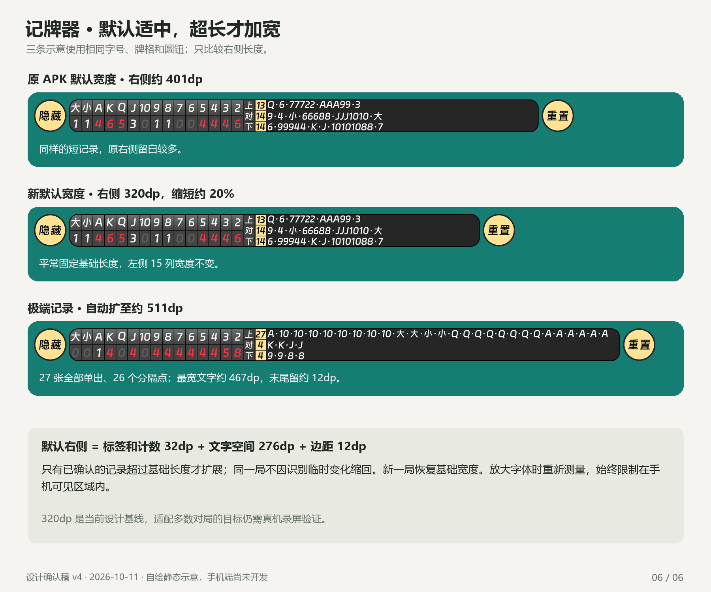

# 三家出牌记录的默认宽度与自动扩展

2026-10-11。用户已确认：**默认采用适合一般对局的固定长度，极端长记录才自动变宽**。以下是静态设计计算，尚未做 Android 字体测量或连续对局统计；不能称为已证明覆盖多数真实对局。

## 1. 默认布局

右侧三家区域的基础宽度设为 **320dp**，原默认约为 **400.556dp**，缩短约 **20.1%**。左侧 15 列保持原 **235.577dp** 宽度，原字体、字号、行高、颜色与圆钮不变。默认不是按开局的空记录缩成很短，也不是从开局就预留整局极端宽度。

| 右侧组成 | 基础宽度 |
| --- | --- |
| 上/对/下标签、黄色累计计数、两处间距 | 32dp（14 + 2 + 14 + 2） |
| 历史文字 | 276dp |
| 末尾余量，包含斜体边缘与圆角避让 | 12dp |
| 合计 | 320dp |

为什么选 320dp：三条已有示例最宽文字约 158.25dp，可以完整显示。用标准牌库各字形的宽度按数量加权，随机发牌下 27 张牌的平均文字约 226.53dp；若分 8 手出完，7 个分隔点增加约 44.14dp，连同标签和边距约 314.67dp，向上取整到 320dp。这是选择初始尺寸的解释性估计，**“8 手”不是已有真实对局的统计结论**。首批连续录屏应检验基础宽度的适用情况，必要时依据实际对局分布微调。

总内容基础宽度为 558.577dp（左侧 235.577 + 分隔 1 + 右侧 320 + 两侧边缘 2），带两个圆钮及间距共 654.577dp。仅计数模式仍为原左侧宽度加边缘，不随本次右侧调整变宽。

## 2. 整局上界计算

约束为标准四人、两副牌，贡牌结束后每人 27 张；普通点数每种最多 8 张，大小王各最多 2 张。只展示真实出过的物理牌面，不把“不出”、贡牌、结算明牌或替代点数追加到出牌历史。每手内部直接拼接，手与手之间用 `·`，不加空格、花色或时间。

最坏记录分成 27 手单张，共 **26 个分隔点**。实际钉钉进步体在 1000 字号时，`10` 宽 1085、大/小各 1000、Q 778、A 727，分隔点 500；不是所有牌都等宽。按牌库容量选最宽的 27 张，组合为 **8 张 10 + 2 大王 + 2 小王 + 8 张 Q + 7 张 A**。不能假设有 27 张 10。

```text
A·10·10·10·10·10·10·10·10·大·大·小·小·Q·Q·Q·Q·Q·Q·Q·Q·A·A·A·A·A·A
```

原详情字号为 `14 × 0.90082836 = 12.61159704sp`。上述文字排版宽约 466.541dp；把首字符 A 的斜体左侧伸出也计入，实际占用约 **466.806dp**。加入 32dp 前缀和 12dp 余量，向上取整为 **511dp**。它是当前字体、默认字号、系统 fontScale=1 下的整局单行保守上界，不能直接作为所有字号/所有玩法的固定上限。

实测了格式内 17 种字符的 289 个相邻组合，当前字体在该格式内的字距均可加和。每减少一次分隔都会变短；字体文件 SHA-256 与已核实参考字体一致。完整数值和可复现脚本见 [计算结果](history-width-analysis.json) 与 [测量脚本](../../tools/design/measure_history.py)。这不是参考 APK 曾保证完整显示整局或具备自动伸缩的证据。

## 3. 运行时规则

1. 新局有效初始化后使用基础宽度，空记录也保留这段长度。
2. 仅在已确认出牌事件提交后，测量三条实际文本的最大占用；临时候选、不出和动画不改变窗口宽度。
3. 所需右侧宽度为 `ceil(标签/计数前缀 + 最长实际文字占用 + 12dp)`。只有超过基础/本局已有宽度时扩展，左侧列宽、字体与高度不变。追加记录不是按手数固定增加一格。
4. 同一局只扩不缩；新局、停止后重新开始或重置到等待后，下一次有效初始化恢复基础宽度。隐藏/显示和关闭/恢复三家区域不清空扩展依据，恢复应容纳当前局的真实记录。
5. 总宽度、左右比例滑块保存的是**基础布局**。默认值只调整这两项，使左侧保持原宽度、右侧基础值为 320dp，其余六项沿用原值。自动扩展只改运行时右侧宽度，不回写滑块、改变比例设置或影响仅计数模式保存值。尺寸页说明「设置基础宽度；记录过长时自动扩展」，预览遵循同一规则。
6. 字体、字号、系统字体缩放或密度改变后，用 Android 实际解析的字体与文本测量结果重新计算，不把 Pillow 的 dp 数字直接当所有手机的像素。默认极端值约 511dp，字号变大时所需宽度也变大。
7. 扩展受横屏可用安全区限制，并扣除当前可见的圆钮和间距。达到屏幕边界时停止扩展，只展示能容纳的最近完整牌组，并以左侧省略标记表示还有更早记录；省略标记本身也参与测量，不截断「10」或一个牌组。完整账本和累计已出不变，不无限缩小字体。具体截断与安全区须真机验收。
8. 在拖动、长按或双击的触摸序列进行中，推迟窗口几何更新至手势结束；记账和数字正常更新，避免窗口移动导致点击误判。扩展不改变左侧锚点，不增加透明触摸占位。

[JPQ 显示默认值](display-defaults.json) 独立保存新增策略与基础参数；[原 APK 默认值](../research/reference-display-defaults.json) 保持研究原值。待开发时将静态计算与真机测量对照，未确认的玩法不得套用 27 张上界。

## 4. 对照图


