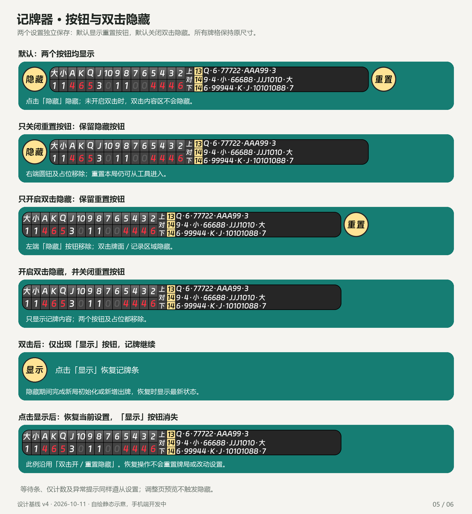

# 记牌器 · 设计确认图 v4

2026-10-11。应用名「记牌器」，JPQ 为工程代号。用户已确认设计并进入开发；以下仍是自绘静态设计，牌局/版本/下载大小均是示例，不能当作 App 实测截图。

保留原 APK 字体、色值、渐变表头、细边框与紧凑行距，以及取消手动改牌、Cloudflare 更新、两个按钮设置等已确定范围。本次将右侧基础宽度改为 320dp，较原约 401dp 缩短约 20%，记录过长才自动加宽；同一局不缩回，新局恢复基础值。末尾留 12dp，左侧牌格与字号不变。宽度/比例滑块保存的是基础尺寸，不随运行时扩展变化。

需要确认的新增交互集中在四项：

1. 移除商业栏目，首页/底部保留记牌与设置。
2. 按钮默认保留，可按已确认要求移除；长按记牌条内容区或可见隐藏按钮进入工具，拖动内容区移动，不触发双击。
3. 冲突自动复核；不可恢复时停止精确显示并等待下局，不设置手动改牌。
4. 每日自动检查，空闲时 Wi-Fi 自动下载，记牌结束后提示安装。

完整规格见 [PRD v4](../PRD.md)，字体/配色证据见 [样式研究](../../research/display-style.md)，长度依据见 [计算说明](../history-width.md)。用户已整体确认 D1–D4 并开始开发。全自动逐手零错漏仍是验收门槛，尚无真实准确率结果；当前进度见 [基础开发记录](../../development/foundation.md)，旧稿可从 Git 历史追溯。

## 1. 启动与设置

## 2. 等待和悬浮记牌条

## 3. 原风格的两页调整

## 4. 工具与应用更新

## 5. 重置按钮开关与双击隐藏

## 6. 基础长度与极端记录扩展

三条对照采用相同字体/字号/左侧列宽。27 张极端记录按实际牌库容量计算，计入 26 个分隔点，默认字号需右侧约 511dp；一般局先使用 320dp 基础宽度，放不下才扩展。320dp 能否覆盖多数真实对局仍待连续录屏验证。
