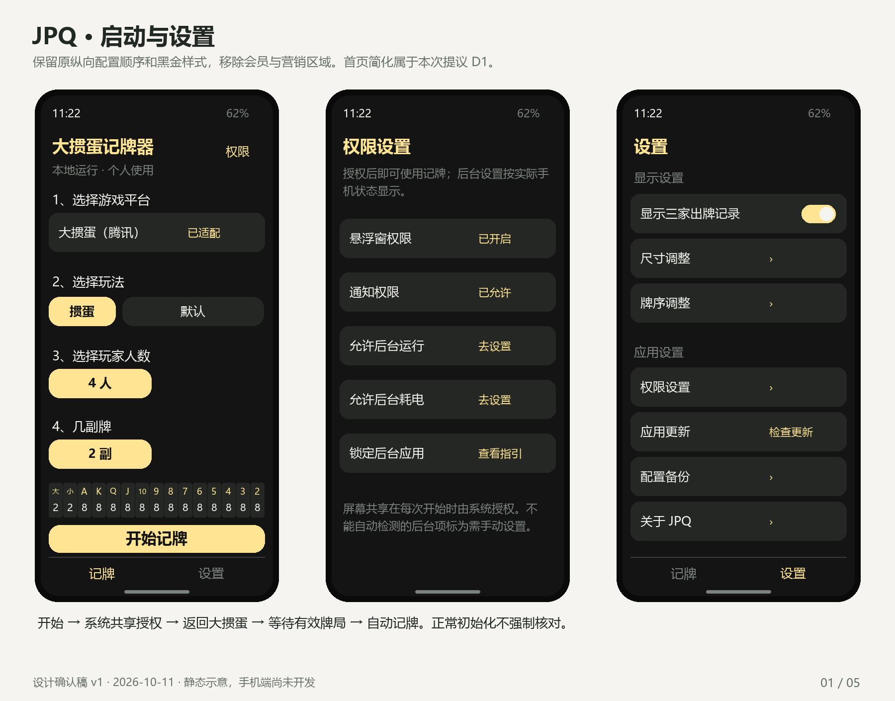
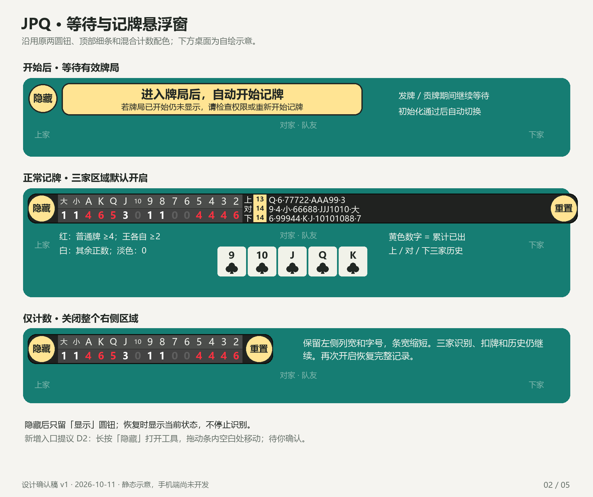
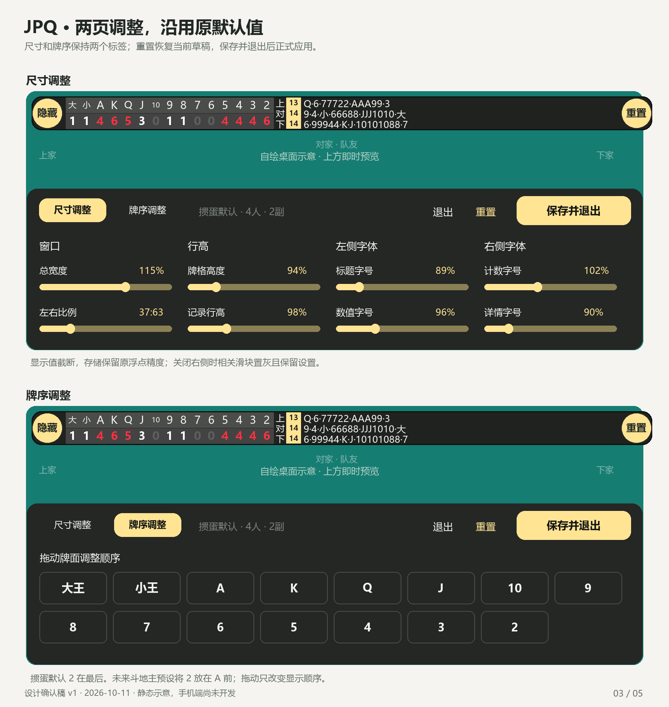
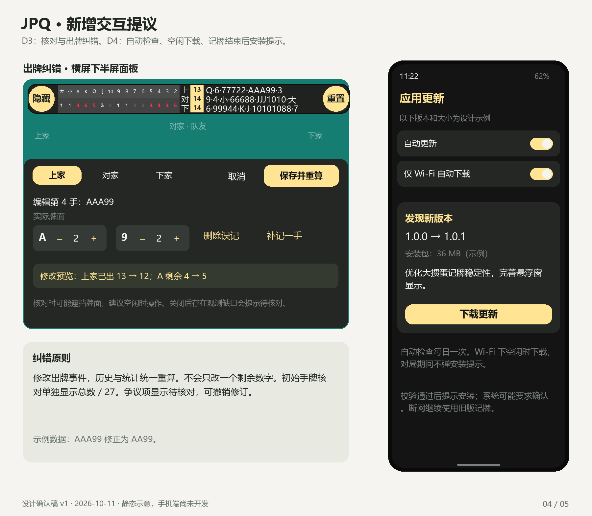
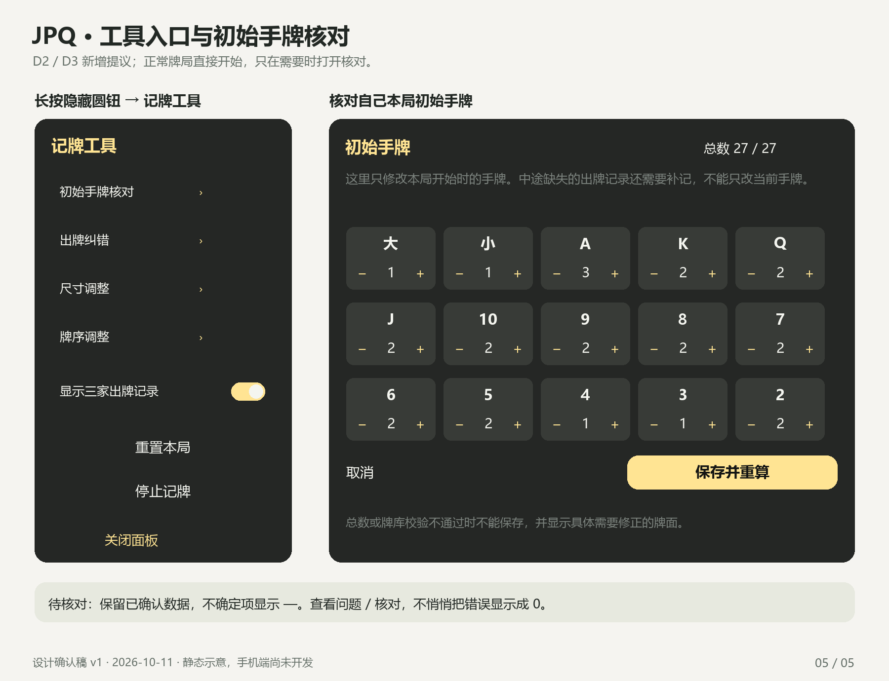

# JPQ 设计确认图 v1

2026-10-11。手机 App 尚未开发。下面是静态设计稿，示例牌面/版本/下载大小不代表识别或发布结果。

本次设计沿用原 APK 的默认大小、混合配色、等待条和尺寸/牌序两页；三家记录可关闭，隐藏与停止区分。大掼蛋大厅截图中的各入口列入适配验证范围，完整规则和样本仍需真机验证。

需要确认的新增交互集中在四项：

1. 移除商业栏目，首页/底部保留记牌与设置。
2. 顶部仍是隐藏和重置两圆钮；长按隐藏打开工具，拖动条内空白处移动。
3. 下半屏核对/纠错，保存后统一重算；异常显示待核对。
4. 每日自动检查，空闲时 Wi-Fi 自动下载，记牌结束后提示安装。

完整行为及异常处理见 [设计确认稿](../PRD.md)。这些新增操作获得用户确认后才进入 Android 开发。

## 1. 启动与设置

## 2. 等待和悬浮记牌条

## 3. 原风格的两页调整

## 4. 出牌纠错及更新

## 5. 工具和初始手牌核对

