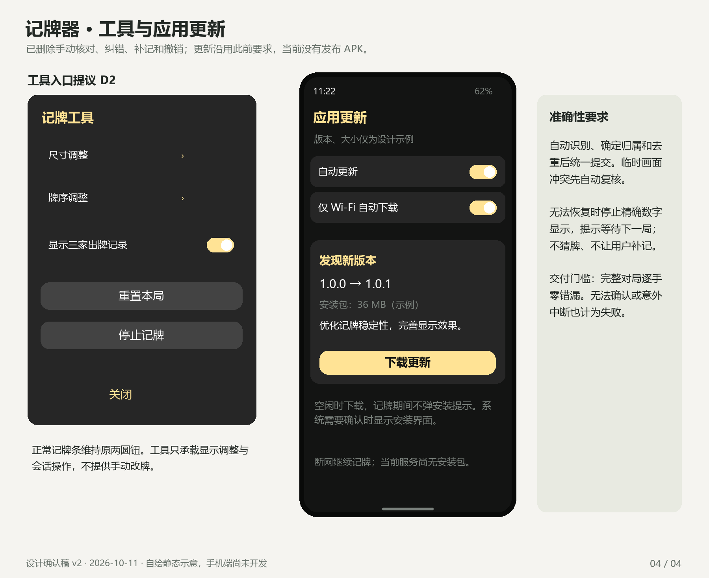

# 记牌器 · 设计确认图 v2

2026-10-11。应用名已确定「记牌器」，JPQ 为工程代号。手机 App 尚未开发；以下为自绘静态设计，牌局/版本/下载大小均是示例。

本次按用户指令删除所有手动改牌功能，保留 Cloudflare 应用自动更新。悬浮窗使用与原 APK 文件哈希一致的官方钉钉进步体，恢复原色值、渐变表头、细边框、圆钮和紧凑行距；调整页恢复宽轨道和竖条滑块。原默认浮点参数未改变。

需要确认的新增交互集中在四项：

1. 移除商业栏目，首页/底部保留记牌与设置。
2. 顶部仍是隐藏和重置两圆钮；长按隐藏打开工具，拖动条内空白处移动。
3. 冲突自动复核；不可恢复时停止精确显示并等待下局，不设置手动改牌。
4. 每日自动检查，空闲时 Wi-Fi 自动下载，记牌结束后提示安装。

完整规格见 [PRD v2](../PRD.md)，实际字体/配色证据见 [样式研究](../../research/display-style.md)。全自动逐手零错漏是验收门槛，尚无准确率实测结果。原版 v1 的纠错与手牌核对图已撤下，可从 Git 历史追溯；不属于开发范围。新增操作确认后才进入 Android 开发。

## 1. 启动与设置

## 2. 等待和悬浮记牌条

## 3. 原风格的两页调整

## 4. 工具与应用更新

