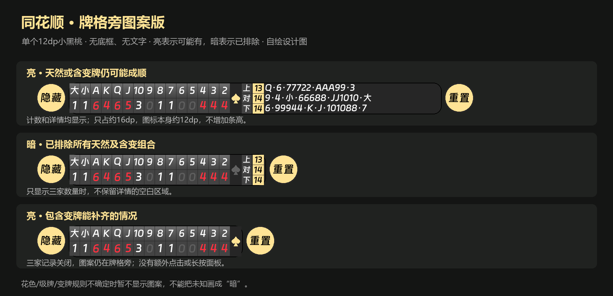
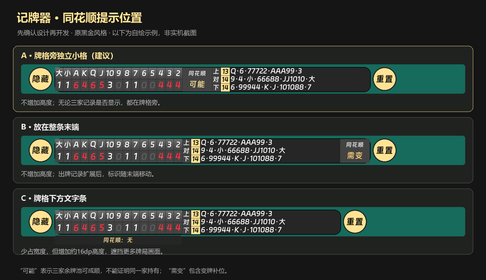
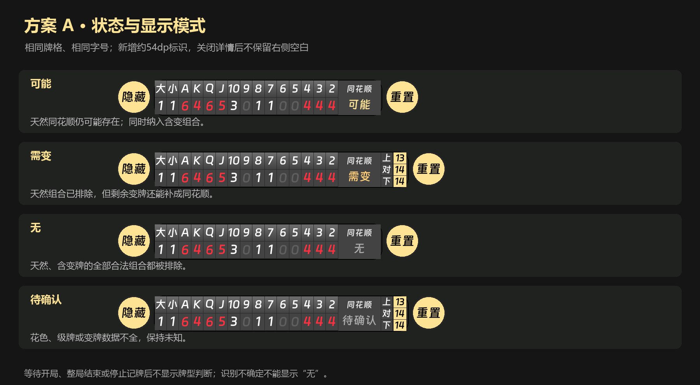

# 同花顺提示 · 待确认方案

2026-10-14。用户要求先确认第6项，当前仅为交互设计，没有修改识别管线或正式悬浮窗。

[打开本机交互预览](index.html)。预览支持四种状态、三家记录的三种显示模式和标识显示开关。使用示例牌局，不是实机结果。字体相对路径读取本地已校验的 overlay.ttf；字体二进制不进入 Git，没有此私有字体时使用系统回退。

建议 A：剩余牌格右侧添加 54dp 两行小格，默认开启并提供设置开关，高度沿用现有记牌条。B 为条尾位置，C 为下方文字条；用户选择后才开发。

用户已选择 A，并要求图案亮暗、不用中文；随后否定五张牌图案，要求更简单、更小。当前修订为 **12dp 单个小黑桃，含留白总宽16dp，无底框、无文字**：天然或含变牌的组合仍可能时亮金色，全部排除时暗灰色。未确认信息期间暂不显示图案，避免把未知误报为“无”；图案没有点击弹窗。下面两张文字版图仅为先前方案历史。

以上由 `tools/design/render_straight_flush.py` 从UI常量自绘、使用原已校验字体，已打开检查布局；不是Android或浏览器截图。浏览器工具禁止本地file协议，因此HTML仅做结构/脚本检查，不宣称完成浏览器交互验证。

| 状态 | 含义 |
| --- | --- |
| 可能 | 三家余牌池仍能组成天然同花顺；含变牌组合也进入计算 |
| 需变 | 所有天然组合已排除，但含变牌的组合仍可能成立 |
| 无 | 天然和含变的全部组合均被排除 |
| 待确认 | 花色、有效级牌/变牌规则或观察数据尚未确认，不能给出确定结果 |

四类语义仍用于内部判断，正式图案只将“可能／需变”合并成亮、“无”变暗、“待确认”暂不绘制。

这里统计三家余牌池，不证明某一家实际有同花顺。本人初始27张不属于该池。自己的牌打出后不能再扣一次。自己出完后展示的队友手牌也不能再作为本人初始牌扣除。

## 判断方案与实现依赖

1. 以四种物理花色建立剩余牌约束：108张，普通牌各点数/花色2张。去除初始本人手牌和三家的真实已出牌，保持来源与不确定性。当前模型只有点数+红黑，不能把红色直接等同红桃或黑色等同黑桃；需要针对已定位牌角补充花色读取。
2. 按有效玩法确认当局级牌与逢人配集合。普通掼蛋按红桃级牌作变牌；双级牌/房间变体另用核实的规则配置，未核实不沿用猜测规则。
3. 对每个花色枚举合法5张连续点数窗口（A2345至10JQKA；不允许QKA23等跨尾环绕）。点数排序独立于用户可拖动的显示牌序。
4. 天然组合：窗口每个点数至少一张同花色未耗用牌。含变组合：明确选取互不重复的物理变牌补空位；红桃级牌在窗口中不能同时当作天然牌和另一位置的变牌。可用2张变牌时检查缺1/2个点数的情况。变牌用过后按实际物理牌扣除，不按替代点数重复扣除。
5. 红黑或变牌身份不完整时保留可行范围。只能在所有与证据一致的分配均排除后显示“无”，否则保守显示“待确认”；不把点数总量充足直接当成四花色确认。
6. 独立小范围花色识别不延长主记牌提交的阻塞路径。状态仅依据已确认观察更新，检测中间帧或短暂颜色闪动不能造成“可能/无”闪烁。测试需要覆盖天然/含变/自然级牌与替代冲突/两张变牌/全部排除/未知花色/队友视角/双级规则。

规则参考：发布者的[《掼蛋入门到精通》红桃级牌配牌章节](https://s.zhangyue.com/read?anchorId=&bid=13354586&cid=9)包含一张、两张红桃级牌配同花顺的示例。[掼蛋运动竞技规范征求意见稿](https://www.ttbz.org.cn/upload/file/20191223/6371270213033087899544901.pdf)列出同花顺及A2345、10JQKA边界。这些用于设计核对，不冒充腾讯具体房间规则；游戏的有效规则仍须从游戏界面验证。
