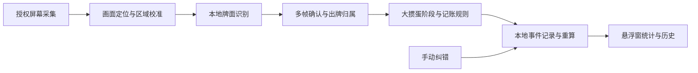

# JPQ 技术设计 · 提议版本

状态：设计待确认，未开始应用实现。目标是复现参考 APK 在大掼蛋中的相关行为，使统计能够解释、纠正和回放验证。

## 1. 架构与扩展



拟采用：Kotlin、Jetpack Compose、WindowManager 原生悬浮窗、MediaProjection/ImageReader、协程、DataStore 设置、Room 事件记录。OpenCV 与 NCNN 属于待样本评测的候选依赖，不提前堆叠多个推理后端。

逻辑划分：

| 层 | 责任 |
| --- | --- |
| app/ui | 首页、权限、初始手牌核对、纠错、设置 |
| capture | 前台采集服务、资源生命周期、最新帧处理与几何回调 |
| vision | 区域定位、牌面/花色识别、置信度、画面证据 |
| game-adapters | 大掼蛋的画面锚点、各家区域、阶段提示；后续新增游戏 |
| rules | 两副牌、贡牌、级牌、每家身份与本局生命周期；后续新增玩法 |
| ledger | 不可变事件、修订、撤销及统计重算 |
| overlay | 记牌条、历史、调整面板和触摸边界 |
| data | 本地设置、事件与模型版本元数据 |
| updates | 独立 Cloudflare 版本检查、可靠下载、校验及 Android 安装流程 |

模块可以先以清晰包边界组织，确认实际规模后再拆 Gradle 模块。通用牌库/事件引擎不依赖具体截图坐标。

## 2. 采集与本地识别

优先允许用户选择只共享大掼蛋；同时测试整屏共享。单应用采集图像与物理屏幕坐标不一定相同，必须分开保存采集坐标到悬浮窗坐标的变换，处理黑边和旋转。

前台服务负责持有采集会话。注册停止、尺寸和可见性回调；只处理最新帧，及时关闭 ImageReader 图像，避免积压。分辨率变化调整现有虚拟显示与 surface；失效 token 不重用。停止后释放虚拟显示、ImageReader、模型会话和悬浮窗口。

画面识别流程：

1. 根据桌面锚点与画面比例定位有效游戏区域，校验是否为可记牌场景。
2. 划分自己的手牌、三家出牌、玩家余牌数字、贡牌/结算提示区域。
3. 屏蔽悬浮窗和会造成误识别的非牌面 UI；手动拖到识别区域时提示或回避遮挡。
4. 检测可见牌面角标，归一化尺度；识别点数、大小王和必要花色，保留位置/置信度。
5. 用几何相邻关系整理一手牌；重叠区域避免把同一牌的多个标识当作多张牌。
6. 使用多帧证据生成出牌事件，交给阶段规则验证，不直接修改计数。

拟比较两条离线路线：

- 固定皮肤的区域模板/轻量分类：成本较低，但必须实测覆盖不同尺寸、叠牌和动画。
- 轻量牌面检测 + 点数/花色分类：更接近参考 APK，需自有或可再分发的训练资产；NCNN 是候选运行时。

选择依据为标注录屏中的整局事件正确性与手机耗电，不能用几张静态截图成功识别作为选型通过。OCR 主要用于阶段提示和余牌数字，不单独承担整套扑克牌识别。

帧率初始建议：等待/静止低频，出牌活动时提高到约 6–10 次观测/秒；实际参数按性能测量调整。参考 APK 的预处理 15 FPS 是配置事实，不能直接作为 JPQ 的性能承诺。

## 3. 状态机

会话层：`未启动 → 待权限 → 采集中 → 暂停/采集失效 → 停止`。暂停可保留已知账本；恢复不能补出未观察的历史。共享停止后重新授权，若存在观测缺口则将本局标记为待核对。

牌局层：

| 阶段 | 允许行为 |
| --- | --- |
| 等待牌局 | 不扣牌，等待桌面/手牌稳定 |
| 发牌中 | 收集候选初始手牌，避免动画直接锁定 |
| 贡牌中 | 跟踪手牌变化和贡牌提示，不生成普通出牌 |
| 初始化核对 | 27 张及牌面稳定性校验，必要时手动核对 |
| 正常出牌 | 确认三家出牌事件并更新历史/统计 |
| 自家出完/队友展示 | 保留自家初始基线与席位，识别队友展示仅作旁观信息 |
| 结算 | 结束本局，保存摘要；等待下一局，不因明牌直接再扣 |
| 待核对 | 明确标记冲突，保留已确认数据和待定候选，用户修正 |

新局初始化需要组合证据：上一局结束或可靠的新局提示、稳定的新发牌画面、阶段转换。仅“看到 27 张牌”不足以认定新局，因为队友明牌/结算明牌也可能符合。

## 4. 多帧确认与去重

每家独立维护候选序列、可见牌组、上次已确认事件及重新允许记账的证据。多帧一致只是确认条件之一，不是新事件判定条件。

- 同一组牌持续显示、闪烁或动画改变位置：保持同一个事件。
- 相同牌组在后续新轮次再次出现：只要有可靠的新出牌边界，即可记为新事件。
- 边界证据来自牌面移除/替换、可靠的轮次变化、对应玩家余牌变化等；短暂空白不足以重新开启一次扣牌。
- 多个区域同时含牌时，依据玩家区域和事件上下文归属，不能仅按中心坐标猜一家。
- 若相同牌组是否属于新出牌无法区分，保留待定项并提示，不用固定冷却时间强行决定。
- 修订后保留原事件身份与屏幕候选关联，避免同一画面立即再次补入已删除事件。

建议事件标识包含会话、本局、玩家、观测边界序号和牌组指纹。指纹只是检查内容，不能独自成为永久去重键。

## 5. 牌库与计算

物理牌面结构：点数、花色（可未知）、大小王类型、识别置信度。两副牌中同点数同花色各 2 张；不可通过画面区分的副本使用数量表示，不凭空分配独立牌 ID。

默认显示未在自己初始手牌内、且尚未由三家打出的物理牌：

```text
U[r] = D[r] - H0_self[r] - P_previous[r] - P_opposite[r] - P_next[r]
```

自家已出 `P_self` 不再扣除；自己的当前手牌可用于检测自家状态与校验，但不能反复替换 `H0_self`。默认不再扣除后来画面中可见的队友手牌，否则会改变参考软件统计口径并存在重复扣除。

玩家已出总数是已确认事件张数之和；正常初始 27 张且无未跟踪转移时，其剩余为 `27 - 已出`。不满足条件时显示未知，不默认为 27。

贡牌完成后建立或刷新基线。若首版后续支持进行中的可见手牌转移，必须记录转移事件，统一重算；不能把转移当打出。

级牌和红心级牌按真实物理点数扣除；逻辑上被当作某点数使用的万能牌另存宣称信息。尚未证明真实牌面可见时，不保证花色/万能牌精确统计。

校验要求：每点数/花色不超牌库；剩余不得为负；每家张数不得异常超出；在标准完整基线下三家剩余总数与 `sum(U)` 一致。**不能把负数静默截断为 0**；冲突必须标记并可以纠正。

配色直接复现已读取的原 APK 方法：普通点数阈值为 4，大王/小王各自阈值为 2；达到阈值为红色，正数但未达阈值为白色，零为淡灰，未知/冲突显示待核对。默认不检查王牌的跨牌种组合，用户已选择保留原配色行为。原颜色值为红色 `#FFFF3140`、白色 `#FFFFFFFF`、零计数 `#26FFFFFF`（白色透明度约 15%）；零计数须在原背景上混合，而非当作不透明 RGB。

着色只保留原软件的剩余数量提醒，不推断牌在同一家，也不把花色未知、万能牌或同花顺推断混入该规则。每次账本重算后重算颜色，普通牌阈值从 4 到 3 或修订恢复到 4 都应立即更新。

## 6. 事件账本与纠错

事件数据建议：局 ID、事件 ID、玩家、阶段、观测时间、牌组、置信度、来源（自动/手动）、识别资产版本、修订引用、可选本地证据区域引用。

初始手牌、出牌、转移、修订、撤销、结束都是事件；显示统计从有效事件重算。保存修订前后预览后提交，支持恢复；不要同时改历史文本和计数两套数据。

默认只保留当前局和少量最近局的结构化账本；截图只在用户开启诊断采样时保存到应用私有目录，设容量上限及清理入口。设置保存在 DataStore，结构化事件保存在 Room。自研应用不集成参考软件的云端上传、会员或设备标识 SDK。

联网仅增加 App 更新用途，Cloudflare 不接收手牌、出牌截图或记牌账本。更新模块失败不改变采集状态、牌局基线或本地数据。服务端部署边界与协议见 [Cloudflare 自动更新](cloudflare-update-plan.md)。

## 7. 悬浮窗与设置

默认展示条与编辑面板分开。展示条紧贴自身可见内容，不建全屏透明触摸层；按钮和拖动手柄有独立触摸范围。Android 12+ 必须实测叠加透明度和底层触摸交付，不能只设置 NOT_TOUCHABLE。

悬浮窗保存：归一化位置、完整模式总宽度、仅计数模式总宽度、左右比例、牌格高度、记录行高、四项字号、牌序、三家记录可见性与统计显示模式。按游戏/玩法/画面比例分组；导入时校验版本、15 类牌唯一性和尺寸边界；旋转后限制在可见安全区。

显示配置「显示三家出牌记录」默认为 true。关闭时移除整个右侧视图及其触摸区域、重新测量窗口，左侧锚点尽量保持；继续保留内部三家出牌识别/账本与纠错入口。再次开启从当前账本渲染完整历史。两个显示模式分别持久化宽度；关闭时禁用左右比例、记录行高及右侧计数/详情字号编辑，但不删除原值。对设置预览和正式悬浮窗采用同一布局约束，避免预览尺寸与实际不一致。

八项调整沿用用户截图：总宽度、左右比例、牌格高度、记录行高、左侧标题/数值字号、右侧计数/详情字号。滑块、拖动、保存退出、重置与退出的交互优先沿用原 APK；实现前核对原操作对应的方法和保存时机，存在无法确认的行为先沟通。

默认参数以 [reference-display-defaults.json](../research/reference-display-defaults.json) 为来源：四人两副牌使用 `Standard` 基准布局和原两副牌调整常量，沿用浮点值、范围与布局公式，不能把截图百分比反推为整数默认值。字体、行高、边框、列间距与 44dp 按钮保留原基准。原尺寸 key 实际为人数/副数，原牌序 key 为玩法；JPQ 仅在必要时扩展保存维度，默认呈现保持原样。关闭右侧后保留左侧列宽/字号，依据可见内容缩短窗口，两个模式分别保存宽度。

显示顺序使用稳定的牌种键列表，不依赖模型输出下标或当前列位置。掼蛋默认 `大、小,A,K,Q,J,10,9,8,7,6,5,4,3,2`，斗地主默认 `大、小,2,A,K,Q,J,10,9,8,7,6,5,4,3`；保持原拖动排序页面并按游戏/玩法保存。切换玩法时读取已保存值，自定义牌序不因新局或级牌改变被覆盖；恢复默认只重置当前玩法牌序。更换顺序不能影响计数、事件牌面或着色。斗地主顺序配置不扩大首版自动识别支持范围。

等待视图复现参考截图的左上角圆形隐藏按钮与金色两行提示条。显示条件为采集有效、记牌会话已启动且本局基线尚未建立；发牌/贡牌时保持等待，稳定初始化后切换为用户配置的记牌条。隐藏是显示状态，不改变采集/初始化；恢复渲染当前状态。重新授权或错误视图不能被等待提示覆盖。新文案见产品方案，布局保持原交互。

整体交互以原 APK 为基线。新的交互优化先提出并获得用户确认后实现；反编译未完整恢复的方法以 Lua、简化指令或真机行为补证，不能凭混淆别名猜操作。

## 8. Git 与交付

研究设计在独立文档分支保存。确认后按功能创建开发分支，提交可解释的变化及验证记录，持续推送指定 origin；避免未经要求覆写远端历史。

构建工具、SDK 和依赖在实现开始时核实并固定版本。当前仅检测到系统 Git/Python，未确认 Android SDK、JDK 和 ADB 可用；设计阶段没有安装完整开发环境。实际签名密钥留在本机，不进入 Git。交付 APK、源码提交版本、安装说明及两部真机测试结果。
