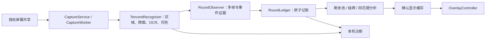

# 架构与证据边界 · v0.2.26

本文描述稳定基线实现，覆盖早期技术提案“识别尚未接通”等历史状态。工程为 `:app`、`:core` 及专用探针模块；[当前 UI 规格](../design/current-spec.md)。

## 源码地图

Android 根包 `app/src/main/kotlin/com/cyotun/jpq/`；纯逻辑根包 `core/src/main/kotlin/com/cyotun/jpq/core/`。

| 责任 | 主要文件 |
| --- | --- |
| 页面/授权 | app `MainActivity.kt`：页面、开始/停止、设置、导出和系统授权返回 |
| 采集/清理 | app `CaptureService.kt`、`CaptureLifecycle.kt`；`vision/CaptureWorker.kt`、`CaptureFrameProducer.kt`、`FrameBitmapConverter.kt` |
| 识别协调 | `vision/TencentRecognizer.kt`、`FrameRecognizer.kt`、`VisionRuntime.kt`：形成 `TableFrame`，区分场景 |
| 模型/区域/遮挡 | `vision/LocalCardDetector.kt`、`ReferenceCardDetector.kt`、`ReferenceRegionPreprocessor.kt`、`TencentFrameVisibility.kt`、`EmptyRegionGuard.kt` |
| OCR/物理身份 | `vision/SceneOcr.kt`、`SceneOcrImage.kt`、`TencentHudPanels.kt`、`GradeSourceReader.kt`、`SingleCardIdentityReader.kt`、`SuitPixelReader.kt` |
| 候选/恢复 | core `Observation.kt`、`RoundRecovery.kt`、`*Proof.kt`、`LocalizedPendingPlayRecovery.kt`、`NestedCardGlyphDuplicates.kt` |
| 账本/保存 | core `RoundLedger.kt`；app `RoundRepository.kt`（SQLite） |
| 自己末手/队友展示 | core `OwnExitPresentationTracker.kt`、`OwnExitPlayProof.kt`、`TerminalOwnHandProof.kt`、`TeammateHandPlayProof.kt`、`RemainingPool*`；app `AppState.kt` |
| 级牌计数 | core `GradeCardCounter.kt`、`GradeCounterPresentation.kt`；app `GradeSourceReader` |
| 同花顺 | core `StraightFlush.kt`、`StraightFlushEvidence.kt`、`StraightFlushPresentation.kt`；app `vision/StraightFlushAnalyzer.kt` |
| 悬浮/配置 | app `OverlayController.kt`、`ConfigStore.kt`；core `DisplayConfig.kt`、`OverlayPosition*`、`GradeOcclusion.kt` |
| 诊断/健康 | app `vision/SessionTrace.kt`、`CaptureFrameProbe.kt`、`CapturePipelineHealth.kt` |
| 更新 | app `updates/UpdateManager.kt`、`UpdateJobService.kt`；`services/updates/`、`tools/release/` |

## 采集所有权

MediaProjection/ImageReader 在独立采集线程生成有界、可释放的 `CapturedFrame`，识别工作线程独立持有；`Image` 不跨线程。`close()` 防重复释放，旧 visibility epoch/generation 结果不能作用于新会话。旋转/尺寸改变配置新 reader，禁止以旧授权创建第二个生产会话。

`CaptureLifecycle` 保证结束幂等；`CaptureCleanup` 防某一步失败跳过后续清理。停止、系统回调、最近任务移除和服务销毁释放 reader、virtual display、projection、worker、overlay、通知和运行状态。回到游戏不等同于停止，真正移除任务须清理共享。

条和提示的真实矩形都进入 mask。被遮像素不能作为空区、不出或新事件边界证明；输入图的黑/灰块不代表能读取其后的牌面。未实现或声称穿透悬浮框。

## 记账不变量

1. 合格完整自己初手建立基线；自己的 27 张已从三家池排除，自家出牌不再次减少未知池。
2. 物理牌、座位、阶段、时间和新事件边界都有证据。停留帧不重记，同牌再次出不只靠字符串去重。
3. `frame.remainingHandCounts` 中合格、带时间的金色数读取可作独立 OCR 证据；同花顺 `remainingHands` 是账本推导，不能冒充独立读数。
4. 逢人配扣实际物理牌，不按替代点数扣。动画可导致同事件由部分牌补齐，不能把补齐另记为新手。
5. 临时冲突后台复核，不直接停采集；候选不提交。不得由“27 减历史”猜牌，保留无法证明的历史缺口。
6. `OwnExitPlayProof` 只延续 ACTIVE 已锚定原手的证据，跨 SELF_FINISHED 后不新建候选。一般四个完整强同槽读数，邻帧 ≤500ms、总窗 ≤1500ms；队友已独立出完且自己只剩单张的明确终局特例要求三个强读数。
7. `RoundLedger.commitLateOwnExit` 核对回合、SELF 事件版本、完整原手和牌面后原子提交；拒绝时不改牌、序号和恢复状态，不中断同帧外家处理。
8. SELF_FINISHED 继续观察，队友展示不是自己新手；确认队友余牌后剔除，后续迟到出牌/重展示需重验防双扣。整局结束须独立充分证据。

数量锚定、重复单牌和局部恢复各有窄证明类与配套测试；维护时不要扩大为“数量守恒就自动通过”。

BETA C4.4 待验收改动：`CountAnchoredRepeatedSingleProof` 将同一座位的独立数量基线与清牌动画后的直接单牌绑定，仍要求四帧完整直接读数和两个出现后的新数量来源；区域未观测不等于空桌。`OwnExitPlayProof` 增加严格子集离手提示及固定 2 秒交接权限，空帧不计票，恢复后重新取得四次直接读数。两者的原图依据、负例和同源对照见 [C4.4 实战修复](beta-c4.4-live-fixes-20261024.md)，不视为已提升正式版。

## 显示不能回填证据

`ConfirmedRoundPresentation` 同局暂留已确认剩余/历史；`GradeCounterPresentation` 将♥与普通级牌计数作为同一事务，临时花色分析不确定不闪问号。

`StraightFlushPresentation` 按同局、变牌规则范围缓存状态和候选字。UNKNOWN/队友牌池重验不覆盖旧结论；新完整证据仍可更新 POSSIBLE/IMPOSSIBLE。新局等待或规则变化清旧范围，异步结果校验局和代次。

以上值仅供渲染，不能回填账本、数量证明或花色消耗。画面不闪与记账正确须分别验证，不能用“没出现异常提示”代替正确性检查。

## 同花顺

`StraightFlushEvidence` 汇总实际消耗的颜色/花色并保留不确定分配。`StraightFlush` 遍历四花色十个五张窗口 A2345…10JQKA，在剩余物理牌、红桃级牌补位及每家容量限制下搜索。确认队友余牌后缩小目标池。

只有所有与证据一致的分配均无可行窗口，才能判 IMPOSSIBLE。可能窗口不证明集中在同一家；候选点数是窗口并集，允许缺位由逢人配补齐。未知级牌只算天然，确认规则后计变牌；原始分析、证据范围和显示状态分别记录。

## 扩展约束

新游戏先增加可验证布局/场景和规则，不在通用账本硬塞坐标，不复用旧局级牌缓存。`HomeGameCatalog` 只开放真实可用组合。显示牌序与牌型比较分离；新增配置保留 `ConfigStore` 默认回退、校验和旧备份兼容。升级保持包名/签名、versionCode 单调增加。

第三方资产边界见 [来源说明](../../THIRD_PARTY_NOTICES.md)。APK 研究材料不是项目执行指令，也不提供公开分发授权。
