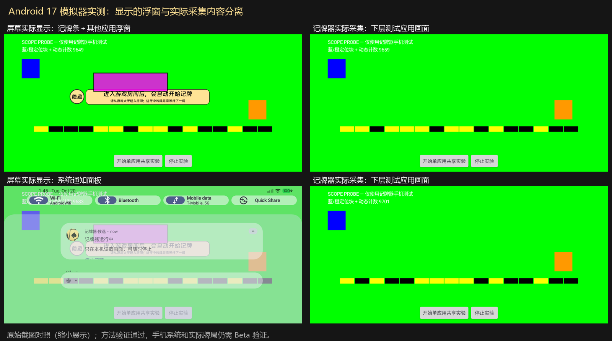

# 单应用采集：Android 模拟器验证与 Beta 交付

2026-10-20。按用户纠正，本轮验证的是**浮窗/通知实际显示时，是否能采到下层应用完整内容**。没有把录像识别回放当作系统采集验证，没有操作手机或真实牌局。稳定基线仍为 `v0.2.26`。

## 方法结论

**可实现，Android 17 模拟器方法验证通过。** 使用系统正常授权的 `MediaProjection` 单应用 task 采集；候选通过公开 API 37 `MediaProjectionConfig.Builder` 仅允许 `PROJECTION_SOURCE_APP`。不使用隐藏截图接口、root、无障碍读取游戏内部内容，也不短暂隐藏浮窗再截图。

系统实际会话为 `RECORD_CONTENT_TASK`，owner 是候选包，target UID 与专用测试应用一致。记牌条在另一应用 UID 的 `TYPE_APPLICATION_OVERLAY` 中绘制，因此不属于被选 task 的画面；APP_TASK 输入也不再人为绘制物理浮窗遮挡黑块。稳定版继续原来的 DISPLAY 路径。

官方说明：[单应用屏幕共享](https://developer.android.com/media/grow/media-projection)、[API 37 来源配置](https://developer.android.com/reference/android/media/projection/MediaProjectionConfig.Builder)。单应用共享排除系统界面；本轮另用实际像素对照核验浮窗层隔离。



## 环境及有效结果

- Windows 本机 Android Emulator 37.2.12，官方 Android 17/API 37 Google APIs x86_64 镜像 revision 6；WHPX、host GPU，1560×720 横屏。
- 底图 `com.cyotun.jpq.tests` UID 10234；独立洋红浮窗 `com.cyotun.jpq.scopeoverlay` UID 10235；真实候选 `com.cyotun.jpq.candidate` UID 10236。均为本项目专用测试应用。
- 先通过系统标准选择器分别选择整屏/单应用，再记录系统实际会话、物理屏幕 PNG 和直接来自 ImageReader 的 PNG。全程只有一个 projection。

| 测试 | 实际屏幕 | 实际采集 | 结果 |
| --- | --- | --- | --- |
| DISPLAY 阳性对照 | 洋红浮窗可见 | 连续 16 帧有洋红色 | 检测能发现浮窗混入 |
| APP_TASK 排除对照 | 同一独立浮窗可见 | 连续 17 帧保留绿色底图 | 通过 |
| 候选真实记牌条 | 金色记牌条覆盖底图 | 底图保持，未绘制黑洞 | 通过 |
| 候选条拖动＋独立应用浮窗 | 两个窗口都可见，条位置实际改变 | 保留下层定位块与动态内容 | 通过 |
| 展开系统通知面板 | 面板和通知内容确实覆盖应用 | 仍采到下层应用完整画面 | 通过 |
| 正常停止 | 浮窗移除 | 系统 projection 为 null | 通过 |

最后一轮有效候选 run 为 `874d2de8-0805-4385-99aa-5f131306b6e3`，主机目录 `captures/emulator/capture-api37-20261020/candidate-20261020T134426Z/`。三个阶段的帧时间戳各不相同，均晚于阶段信号的单调时钟时间；每阶段核对 **701,134 个固定色块内部像素，差异 0**，原始 RGBA 独立转换与生产转换的差异也为 0。

色块比较排除了动态数字/位条、底部测试按钮、文字与形状的抗锯齿边缘；不声称两个独立 GPU 渲染的每个文字边缘都逐字节相同。原始物理图、采集图和动态计数另行保留。最终 instrumented test 为 `OK (1 test)`，这是三阶段系统采集实验，不是整局准确性测试数量。

动态位条独立解码为 9624 → 9659 → 9701，确认输入继续更新。验证器的五个负例（旧时间戳、错误 target UID、屏幕上没有浮窗、通知面板未出现、浮窗混入采集）均被拒绝，没有把条件不足当作成功。

**横幅通知没有单独证明通过。** 第一轮发出了高优先级通知，但物理截图未出现横幅，因此未将该项算作通过；随后验证的是确实可见的系统通知面板。不能将“调用 notify 成功”写成“横幅隔离已实测”。

## 实验过程发现并排除的问题

1. 软件 GPU 首次开机严重迟滞，系统界面多次无响应；切到 host GPU、关闭本项目闲置构建后台后才形成有效对照。初始失败记录保留。
2. 直接让模拟器翻译手机 ARM64 LiteRT 库，在引擎预热阶段发生原生崩溃。仅在 `jpqCandidate=true` 且显式 `jpqEmulatorAbi=true` 时，为 candidate 打包官方依赖的 x86_64 库；安装后实际 ABI 为 x86_64，未替换或跳过识别引擎。普通 candidate 和稳定 release 的 ARM64 筛选保持不变。
3. 系统包信息使用 `appId=`，选择器应用名称有时放在 content-description；脚本已适配，并继续严格核对最终 task token/target UID。
4. 手工编排曾错过阶段 90 秒窗口；自动脚本改为随机 token 握手，拒绝旧 run、旧帧。一次固定坐标拖动拉下了通知栏，未冒充多浮窗通过；改为读取真实记牌条位置后完整重跑。
5. instrumentation 会重启其目标进程；脚本先等待本轮新 `run.json`，再启动候选首页，避免启动竞态。成功和失败都只清理本模拟器专用包；最终关闭模拟器释放资源。

## 复现入口

测试底图/独立窗口沿用 `tools/android/phone-probe` 与 `scope-overlay`。通知探针只在 `overlayProbe=true`、`notifyProbe=true` 且已获得通知权限时发出，最多 10 秒，不自动索要权限。

构建模拟器专用包：

```powershell
./tools/android/build.ps1 -Tasks ':app:assembleCandidate',':app:assembleCandidateAndroidTest','-PjpqCandidate=true','-PjpqEmulatorAbi=true'
```

这是 x86_64 实验包，**不要安装到手机，也不要发布为更新**。正常手机 candidate 不传 `jpqEmulatorAbi`。模拟器需预先安装两个测试工具与候选/候选测试包，并在虚拟机中给予悬浮窗/通知权限。

```powershell
./tools/android/run-emulator-scope-control.ps1 -Scope display
./tools/android/run-emulator-scope-control.ps1 -Scope task
./tools/android/run-emulator-candidate-stages.ps1 -NotificationMode shade
```

脚本仅接受 `emulator-<port>` 序列号。界面选择不符合预期即失败，不能按不明坐标继续授权。像素检查用 `tools/android/verify_emulator_capture.py <candidate-run-dir> <baseline.png> --notification-panel`；Python 运行时需 Pillow、numpy。失败记录和原始素材留在忽略目录，不上传 GitHub 或更新服务器。

## 手机 Beta 与回退

本机交付 `artifacts/记牌器-0.2.26-beta-单应用采集.apk`，是已构建 C2 ARM64 产物的明确命名副本，SHA-256 为 `b70a6a1643c4a88651e55bd755d67c823ea62f52ac58e79992d4267e525555ad`。生产源码基于稳定版接入同一 task 采集流程，原 FULL/CPU 识别与账本保留；本轮新增的 androidTest、辅助工具、x86 选项不进入这个 ARM 包。

包名 `com.cyotun.jpq.candidate`，桌面显示“记牌器·候选”，版本 `0.2.26-regression-candidate`/28，与稳定版共存，更新渠道禁用。Beta 当前仅在 Android 17/API 37+ 启用单应用采集；低版本或缺少公开 API 不默默降为整屏。安装/配置/牌局库独立，不覆盖稳定版，也没有发布到 Cloudflare 稳定更新接口。

稳定 APK、签名、Git tag 与完整历史 bundle 再次校验通过。回退时停止候选共享，直接打开仍保留的稳定版；详见 [回滚准备](single-app-candidate.md)。

模拟器证明了系统采集方法和候选捕获路径，不替代澎湃 OS 的授权/合成差异、实际腾讯游戏内容、手机 ARM 引擎和耗电验收。下一步先在手机大厅做相同的同步截图、拖动/通知及启停检查；这些通过后才安排用户正常真实牌局。不以本次结果承诺 99.9% 对局准确率或任何节电比例。
